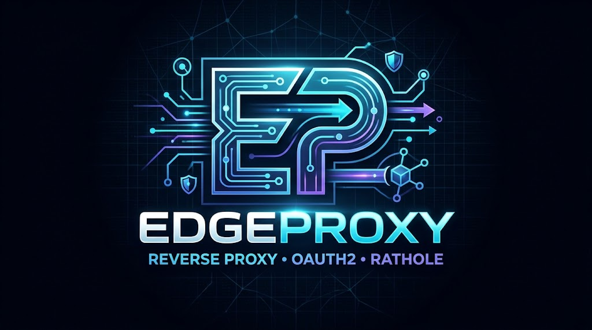

<p align="center">
  
</p>

# EdgeProxy

[](LICENSE)
[](https://github.com/asphalter/edgeproxy/pkgs/container/edgeproxy-server)
[](https://docs.podman.io/en/latest/markdown/podman-systemd.unit.5.html)
[](https://noiseprotocol.org/)

**EdgeProxy** is a modern, self-hosted alternative to **Cloudflare Tunnel + Cloudflare Access (Zero Trust)**. It securely exposes internal network services (homelab, LAN servers, local workstations, Docker/Podman environments) to the public Internet through your own VPS gateway—**without third-party traffic decryption, vendor lock-in, or proprietary SaaS agents**.

---

## Why EdgeProxy?

| Feature | Cloudflare Tunnel + Access | EdgeProxy |
| :--- | :--- | :--- |
| **Traffic Decryption** | Decrypted at Cloudflare Edge (Third-Party MITM) | **Decrypted strictly on your own VPS** |
| **Infrastructure Control** | Proprietary SaaS cloud | **100% Self-Hosted on any cheap Linux VPS** |
| **Authentication** | Cloudflare Access IdP | **Integrated Google OAuth2 SSO & Service Tokens** |
| **Tunnel Encryption** | Proprietary `cloudflared` | **Noise Protocol (ChaCha20-Poly1305 + Curve25519)** |
| **Inbound Ports on LAN** | None (Outbound tunnel) | **None (Outbound tunnel over WAN :2333)** |
| **Deployment Complexity** | Proprietary cloud console | **1 Podman Quadlet unit file per node** |
| **Configuration Sync** | Cloud daemon | **Zero-Touch background polling (15s)** |

---

## Key Features

- **Single-Container Architecture**: Both server and client run as independent, compact, all-in-one OCI container images managed natively by **Podman Quadlet / systemd**. No multi-container pod complexity, no complex docker-compose dependencies, and no manual `.env` file management.
- **Google OAuth2 SSO**: Native identity federation with Google Workspace and standard Gmail accounts. Protect any web service without modifying backend code.
- **Granular Per-Host Access Policies**:
  - `Google OAuth2`: Requires valid Google authentication, with optional per-host email whitelists.
  - `Service Token`: Headless API machine-to-machine authentication matching `CF-Access-Client-Id` and `CF-Access-Client-Secret` headers.
  - `Bypass`: Fully public HTTPS access (e.g. public sites, webhooks).
- **Hardened Caddy v2 Edge**: HTTP/3 QUIC support, automatic Let's Encrypt / ZeroSSL ACME TLS certificate issuance and renewal, anti-fingerprinting (`Server: EdgeProxy`), hidden dotfile blocking, strict security headers (HSTS, nosniff, SAMEORIGIN, Permissions-Policy), and DoS payload limits.
- **High-Performance Rathole Tunnel**: Multiplexed reverse proxy built in Rust utilizing `Noise_NN_25519_ChaChaPoly_BLAKE2s` cryptographic transport for minimal latency and maximum throughput.
- **Technical Obsidian Dark Web UI**: Sleek high-contrast management dashboard to configure hosts, inspect real-time connection state, view live Caddy access logs, analyze bandwidth consumption, and export/import configuration backups.
- **Live Latency & Health Telemetry**: End-to-end client-to-server RTT latency measurements via active handshakes, visual color-coded status badges, and remote agent heartbeat reporting.
- **WebSocket & Long-Polling Tuning**: Configurable per-host read, write, dial, and idle timeouts, plus flush intervals for high-frequency WebSocket and streaming endpoints.
- **Zero-Touch Dynamic Synchronization**: Client container syncs changes automatically from the server every 15 seconds via authenticated Bearer API token, with automatic config reload and offline caching fallback.

---

## Architecture Overview

### Componenti Architetturali

| Componente | Ambito / Ubicazione | Porte / Endpoint | Ruolo e Funzione |
|---|---|---|---|
| **User / Client** | Rete Pubblica / Internet | `:443` HTTPS / HTTP/3 QUIC | Browser utente o client API esterno che richiede l'accesso a un servizio esposto |
| **Caddy v2 Edge** | VPS Edge Gateway | `:80`, `:443`, `:2019` | Reverse proxy primario, terminazione TLS/ACME automatica, applicazione policy di sicurezza e instradamento |
| **OAuth2-Proxy** | VPS Edge Gateway | `127.0.0.1:4180` | Endpoint locale `/oauth2` per autenticazione Single Sign-On Google ed enforcement email whitelist |
| **EdgeProxy Manager** | VPS Edge Gateway | `127.0.0.1:8000` | UI di controllo FastAPI per gestione host, monitoraggio link, metriche e distribuzione configurazioni |
| **Rathole Server** | VPS Edge Gateway | `0.0.0.0:2333` (WAN)<br>`127.0.0.1:8001+` (LAN) | Ricezione tunnel crittografato Noise e bridging delle porte locali verso Caddy |
| **Rathole Client & Sync Agent** | LAN Privata / Homelab | Outbound verso `:2333` | Connessione solo in uscita verso il VPS, polling configurazioni ed inoltro ai servizi interni |
| **Backend Services** | LAN Privata / Homelab | Porte interne (es. `:8080`, `:9443`) | Applicazioni target protette (Proxmox, Home Assistant, NAS, web app private) |

### Flusso di Traffico End-to-End

| Step | Origine | Destinazione | Canale / Protocollo | Descrizione |
|:---:|---|---|---|---|
| **1** | Client / Browser | Caddy Edge (VPS) | `HTTPS` / `HTTP/3 QUIC` (`:443`) | La richiesta in ingresso arriva al VPS con certificato ACME valido. |
| **2** | Caddy Edge | OAuth2-Proxy / Manager | `HTTP` (`127.0.0.1:4180` / `:8000`) | Caddy valida l'autenticazione richiesta (`Bypass`, `Google OAuth2`, o `Service Token`). |
| **3** | Caddy Edge | Rathole Server | Loopback TCP (`127.0.0.1:8001+`) | A richiesta autorizzata, Caddy inoltra il traffico alla porta locale assegnata all'host. |
| **4** | Rathole Server | Rathole Client | Noise Tunnel WAN (`:2333`) | Multiplexing crittografato ad alte prestazioni su connessione stabilita in uscita dal client. |
| **5** | Rathole Client | Servizio Backend LAN | LAN TCP/HTTP (`192.168.x.x`, ecc.) | Il client consegna il payload al server o container locale senza esporre porte sul router. |

### Process Coordination Inside `edgeproxy-server`
The all-in-one server container uses `supervisord` to coordinate four local processes over loopback:
1. **Caddy** (`:80`, `:443`, `:2019`): Ingress reverse proxy and ACME certificate manager.
2. **OAuth2-Proxy** (`127.0.0.1:4180`): Google identity validation endpoint (`/oauth2/auth`).
3. **Rathole Server** (`0.0.0.0:2333` WAN, `127.0.0.1:8001+` loopback): Encrypted tunnel termination.
4. **EdgeProxy Manager** (`127.0.0.1:8000` / `0.0.0.0:8000`): FastAPI management control plane and telemetry engine.

All persistent states (SQLite `edgeproxy.db`, Caddy TLS certificates, Rathole keys, and logs) reside inside the single unified volume `/data`.

---

## Quick Start Deployment (Podman Quadlet)

EdgeProxy is designed for zero-headache deployment via **Podman Quadlet** (native `systemd` integration).

### Step 1: Deploy EdgeProxy Server on your VPS

1. Ensure [Podman](https://podman.io/) is installed on your Linux VPS.
2. Ensure DNS records for your domain point to your VPS public IPv4:
   - `yourdomain.com` (A record)
   - `*.yourdomain.com` (CNAME or wildcard A record)
3. Create the Quadlet container file at `/etc/containers/systemd/edgeproxy-server.container`:

```ini
[Unit]
Description=EdgeProxy Server (All-in-One)
After=network-online.target
Wants=network-online.target

[Container]
ContainerName=edgeproxy-server
Image=ghcr.io/asphalter/edgeproxy-server:latest
PublishPort=80:80/tcp
PublishPort=443:443/tcp
PublishPort=443:443/udp
PublishPort=2333:2333/tcp
PublishPort=8000:8000/tcp
Volume=edgeproxy_data.volume:/data:z
Environment=DOMAIN=yourdomain.com
Environment=ACME_EMAIL=admin@yourdomain.com

[Service]
Restart=always
TimeoutStartSec=300

[Install]
WantedBy=multi-user.target
```

4. Create the persistent volume definition at `/etc/containers/systemd/edgeproxy_data.volume`:

```ini
[Unit]
Description=EdgeProxy Persistent Data Volume (/data)

[Volume]
VolumeName=edgeproxy_data
```

5. Reload systemd and start EdgeProxy:

```bash
sudo systemctl daemon-reload
sudo systemctl enable --now edgeproxy-server.service
```

6. Open your browser and access the Manager UI:
   - Direct: `http://<VPS-IP>:8000` (or `https://manager.yourdomain.com` once DNS is active)

---

### Step 2: Configure Google OAuth2 (Optional but Recommended)

1. Go to [Google Cloud Console](https://console.cloud.google.com/apis/credentials) and create an **OAuth 2.0 Client ID** (Web Application).
2. Configure Authorized redirect URIs:
   - `https://auth.yourdomain.com/oauth2/callback`
3. Configure Authorized JavaScript origins:
   - `https://auth.yourdomain.com`
4. In the EdgeProxy Manager UI, navigate to **Settings** (`/settings`):
   - Check **Enable Google OAuth2 Federation**.
   - Paste your **Client ID** and **Client Secret**.
   - Specify globally allowed email addresses (e.g. `yourname@gmail.com`).
   - Click **Save Settings & Apply**.

---

### Step 3: Add Your First Backend Host

1. In the EdgeProxy Manager UI, go to **Hosts** (`/hosts`).
2. Click **+ Register New Host**:
   - **Public FQDN Domain**: `dashboard.yourdomain.com`
   - **Upstream Target Backend**: `http://192.168.1.50:8080` (or your LAN/Docker IP)
   - **Access Policy**: `Google OAuth2` (or `Bypass` for public access)
   - **Security Headers**: Checked
3. Click **Save Host**. The manager will assign an internal tunnel port (e.g. `8001`), generate cryptographic tokens, and update Caddy automatically.

---

### Step 4: Deploy EdgeProxy Client on your LAN / Private Server

1. In the EdgeProxy Manager UI, navigate to **Client Config** (`/client-config`).
2. EdgeProxy automatically generates a ready-to-run, pre-populated Quadlet snippet containing your server URL, public tunnel address, and sync token.
3. Click **📋 Copy Client Quadlet**.
4. On your private local server or homelab machine, create `/etc/containers/systemd/edgeproxy-client.container`:

```ini
[Unit]
Description=EdgeProxy Client (All-in-One)
After=network-online.target
Wants=network-online.target

[Container]
ContainerName=edgeproxy-client
Image=ghcr.io/asphalter/edgeproxy-client:latest
Network=host
Volume=edgeproxy_client_data.volume:/etc/rathole:z
Environment=SERVER_URL=https://auth.yourdomain.com
Environment=SYNC_TOKEN=your_generated_sync_token_here
Environment=INTERVAL=15

[Service]
Restart=always
TimeoutStartSec=300

[Install]
WantedBy=multi-user.target
```

5. Create `/etc/containers/systemd/edgeproxy_client_data.volume`:

```ini
[Unit]
Description=EdgeProxy Client Persistent Configuration Volume (/etc/rathole)

[Volume]
VolumeName=edgeproxy_client_data
```

6. Reload systemd and start the client:

```bash
sudo systemctl daemon-reload
sudo systemctl enable --now edgeproxy-client.service
```

That's it! The client immediately fetches its service configuration, opens an encrypted Noise reverse tunnel to the VPS, and starts streaming heartbeats and latency metrics. Your local service is now live at `https://dashboard.yourdomain.com`.

---

## Service Token Authentication (Headless / API)

For automated CI/CD runners, mobile applications, or headless API clients where interactive Google login is impossible:

1. In **Hosts**, set the Access Policy to **Service Token (API / Machine)**.
2. The UI generates a secure random 32-character service token.
3. Configure your API client or HTTP library to include the headers:
   ```http
   CF-Access-Client-Id: <domain>
   CF-Access-Client-Secret: <service_token>
   ```
4. Requests without valid headers are rejected at the edge with `401 Unauthorized` before reaching your private network.

---

## Web UI & Telemetry

The EdgeProxy Manager provides a high-contrast terminal interface accessible from desktop and mobile:
- **Dashboard**: Real-time summary of active tunnels, Google OAuth2 health, link latency, and quick actions.
- **Hosts**: Full CRUD for exposed endpoints, TLS verification flags, WebSocket timeout adjustments, and per-host email filters.
- **Client Config**: Pre-compiled Quadlet generator, raw TOML exports, and standalone bash sync script options.
- **Link Telemetry**: Live ping latency graphs, client agent uptime, handshake status, and remote client logs.
- **Traffic Stats**: Bandwidth distribution charts, top requests by domain, and searchable Caddy access logs.
- **Settings & Backup**: OAuth configuration, global email whitelists, and one-click JSON backup export and atomic restore.

---

## Local Development & Image Building

To build both OCI container images locally from source:

```bash
# Clone the repository
git clone https://github.com/asphalter/edgeproxy.git
cd edgeproxy

# Build both images locally
./scripts/build-images.sh all

# Or build selectively
./scripts/build-images.sh server
./scripts/build-images.sh client
```

### Running Test Suite

Run the full Python test suite in an isolated ephemeral Podman container:

```bash
podman run --rm -v "$(pwd):/workspace:z" -w /workspace python:3.12-slim bash -c \
  "pip install --no-cache-dir -r server/manager/requirements.txt && python3 -m unittest discover tests"
```

Validate the Caddyfile configuration syntax:

```bash
bash tests/validate_configs.sh
```

---

## Troubleshooting

### Checking Server Process Status
Because the server runs inside an all-in-one container managed by `supervisord`, inspect all child processes directly:

```bash
# View supervisord child process statuses
podman exec -it edgeproxy-server supervisorctl status

# View live rathole server logs
podman exec -it edgeproxy-server tail -f /var/log/rathole.log

# View systemd container unit logs
journalctl -u edgeproxy-server.service -f
```

### Checking Client Connection
```bash
# View client unit logs and sync activity
journalctl -u edgeproxy-client.service -f

# Inspect active cached client configuration
podman exec -it edgeproxy-client cat /etc/rathole/client.toml
```

---

## Security Model

- **No Public Backend Ports**: Your local backend servers never listen on public interfaces; all traffic passes through an outbound-initiated tunnel.
- **ChaCha20-Poly1305 Cryptography**: Traffic over WAN is protected with modern Noise Protocol primitives, safeguarding against network eavesdropping.
- **Zero Third-Party Decryption**: Unlike SaaS cloud proxies, TLS terminates strictly on your own VPS. Private keys and payload data never touch commercial intermediary servers.
- **Perimeter Hardening**: Caddy strips identifying server signatures, drops requests to hidden files (`.*/.*`), enforces HSTS, and limits request body buffers to defend against memory exhaustion attacks.

---

## License

This project is open-source software licensed under the [MIT License](LICENSE).
