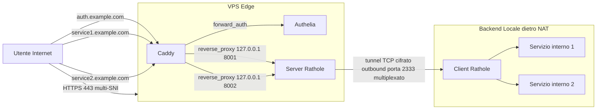
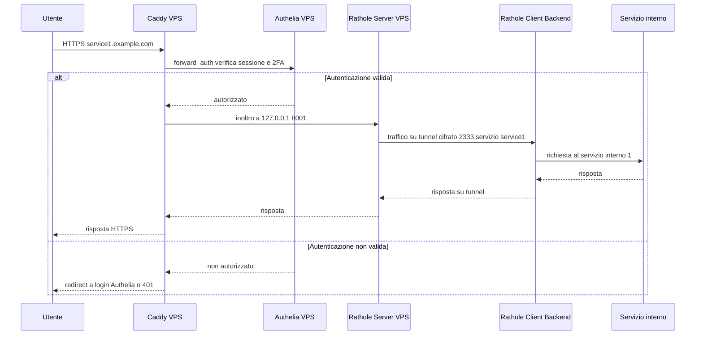
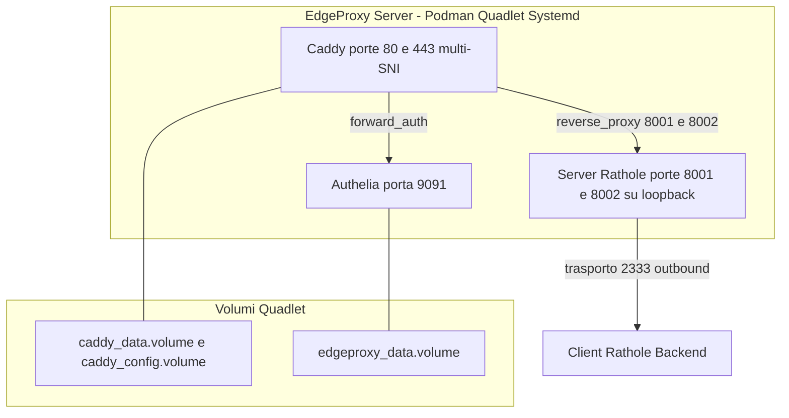

# EdgeProxy — Specifica Architetturale

> **Stato**: Progettazione architetturale (nessun codice implementativo, nessun container avviato).
> **Direttiva**: "Fammi il progetto e non partire a sviluppare."
> Questo documento è la sorgente di verità per le fasi successive di implementazione.

---

## 1. Obiettivo

Migrare l'esposizione dei servizi attualmente gestita tramite **Cloudflare Tunnel**
(autenticazione Cloudflare Access 2FA via Google Authenticator e SSL automatico) verso una
**VPS proprietaria con IPv4 pubblico**, preservando:

- Autenticazione a due fattori (TOTP / Google Authenticator).
- Rinnovo automatico dei certificati SSL/TLS.
- Policy di accesso per servizio/utente/gruppo.
- Nessuna porta in ingresso sul backend locale (NAT traversal tramite reverse tunnel).

---

## 2. Stack Tecnologico

| Ruolo | Componente | Posizione |
|-------|-----------|-----------|
| Reverse tunnel | Rathole (server) | VPS |
| Reverse tunnel | Rathole (client) | Backend locale |
| Reverse proxy + TLS automatico | Caddy | VPS |
| Autenticazione/2FA/Autorizzazione | Authelia | VPS |
| Container runtime | Podman | VPS + Backend |

---

## 3. Architettura Logica

### 3.1 Vista d'insieme



Caddy gestisce più **SNI** (Server Name Indication) su un unico ascoltatore `443`: ogni
dominio/virtual host è un blocco sito dedicato nel [`Caddyfile`](server/caddy/Caddyfile),
termina TLS con certificato automatico e instrada il traffico autorizzato verso una porta di
binding locale distinta del Rathole Server.

### 3.2 Flusso del traffico in ingresso

1. Internet -> IPv4 pubblico VPS -> porta **443** con SNI del dominio richiesto.
2. **Caddy** seleziona il blocco sito in base allo SNI e termina TLS per quel dominio.
3. Caddy applica lo snippet `forward_auth` e interroga **Authelia**.
4. Authelia verifica sessione e 2FA TOTP; se valida restituisce esito positivo.
5. Se autorizzato, Caddy inoltra la richiesta alla **porta di binding locale** dedicata
   (`127.0.0.1:8001` / `127.0.0.1:8002`) del **Rathole Server**.
6. Rathole Server trasmette la richiesta sul **singolo tunnel TCP cifrato** (porta `2333`)
   multiplexando il servizio di destinazione.
7. Rathole Client demultiplexa e inoltra al **servizio locale interno** corrispondente.



### 3.3 Flusso del tunnel e multiplexing

1. Il **Rathole Client** (backend) apre **una sola connessione TCP cifrata outbound** verso il
   **Rathole Server** sulla VPS, sulla porta di trasporto `2333`.
2. Il canale resta attivo e viene mantenuto con riconnessione automatica.
3. Nessuna porta in ingresso viene aperta sul backend.
4. Tutti i servizi sono **multiplexati** sul medesimo canale di trasporto: ogni servizio è
   identificato dal proprio nome (`[server.services.<name>]` / `[client.services.<name>]`) e
   dal proprio token condiviso.
5. Sul server, ciascun servizio espone una **porta di binding locale dedicata** su loopback
   (`127.0.0.1`) raggiungibile esclusivamente da Caddy.
6. Sul client, ciascun servizio è mappato verso il rispettivo endpoint del backend locale.

---

## 4. Strategia Podman

### 4.1 Ambiente VPS (server-side)

Topologia consigliata: **Podman Quadlets** (systemd) orchestrando il container All-in-One server (Caddy + Authelia + Rathole) o container dedicati:



**Scelta raccomandata**: **Podman Quadlet** nativo per systemd (rootless). Fornisce avvio automatico al boot con supervisione nativa systemd, restart automatico, gestione delle dipendenze da rete e storage persistente dichiarativo tramite file `.volume`.

| Componente | Immagine consigliata | Porte esposte | Note |
|-----------|---------------------|---------------|------|
| Caddy | `caddy:2` | `80:80`, `443:443` | TLS automatico multi-SNI, `forward_auth` verso Authelia |
| Authelia | `authelia/authelia:latest` | solo interna `9091` | storage SQLite + file utenti su volume |
| Rathole Server | `rapiz1/rathole:latest` | `127.0.0.1:8001`, `127.0.0.1:8002` su loopback; trasporto `2333` | canale cifrato multiplexato, un binding locale per servizio |

**Reti**:
- Rete interna condivisa per Caddy -> Authelia e Caddy -> Rathole Server.
- Solo Caddy espone `80` e `443` all'esterno; i binding dei servizi Rathole restano su
  `127.0.0.1` e non sono raggiungibili dall'esterno.
- La porta di trasporto `2333` del Rathole Server è raggiungibile dal backend; deve essere
  limitata via firewall alla sola provenienza del backend (o a una rete/VPN dedicata).

**Volumi persistenti**:
- `caddy_data` / `caddy_config` per certificati e configurazione Caddy.
- `authelia_config` per `configuration.yml`, `users.yml` e `db.sqlite3`.

### 4.2 Ambiente Backend (client-side)

Topologia: un singolo container Podman leggero con **Rathole Client**.

| Componente | Immagine consigliata | Porte | Note |
|-----------|---------------------|-------|------|
| Rathole Client | `rapiz1/rathole:latest` | nessuna porta in ingresso | solo connessioni outbound |

**Requisiti client**:
- Accesso di rete ai servizi locali interni da esporre.
- Montaggio del file di configurazione client.
- Politica di restart `always` per mantenere il tunnel attivo.

---

## 5. Alberatura delle Directory di Progetto

```text
edgeproxy/
├── memory-bank/
│   ├── productContext.md
│   ├── systemPatterns.md
│   ├── techContext.md
│   ├── activeContext.md
│   └── progress.md
├── plans/
│   └── architecture-spec.md
├── server/
│   ├── Containerfile               # Container All-in-One
│   ├── supervisord.conf            # Supervisor multi-processo
│   ├── quadlet/                    # Unità systemd Podman Quadlet
│   │   ├── edgeproxy-server.container
│   │   ├── caddy_data.volume
│   │   ├── caddy_config.volume
│   │   └── edgeproxy_data.volume
│   ├── caddy/
│   │   └── Caddyfile               # reverse proxy + forward_auth
│   ├── authelia/
│   │   ├── configuration.yml       # configurazione Authelia
│   │   └── users_database.yml      # utenti e gruppi (hash password)
│   └── rathole/
│       └── server.toml             # Rathole server
└── client/
    ├── Containerfile               # Container client
    ├── quadlet/                    # Unità systemd Podman Quadlet
    │   └── edgeproxy-client.container
    └── rathole/
        └── client.toml             # Rathole client
```

> **Nota**: i file di configurazione implementativi (`Caddyfile`, `configuration.yml`,
> `server.toml`, `client.toml`, unità `.container` e `.volume`) sono gestiti tramite Quadlet systemd.

---

## 6. Bozze Concettuali dei File di Configurazione

> Le bozze seguenti descrivono il **modello multi-SNI e multi-servizio**. I valori tra `<...>`
> sono segnaposto; gli esempi concreti usano i domini `auth.example.com`,
> `service1.example.com`, `service2.example.com` come riferimento progettuale.

### 6.1 [`Caddyfile`](server/caddy/Caddyfile) — server-side VPS, multi-SNI TLS

Caddy termina TLS per ciascun SNI in modo automatico: ogni blocco sito genera/gestisce il
proprio certificato. Lo **snippet riutilizzabile** `(authelia_auth)` incapsula la direttiva
`forward_auth`, evitando duplicazioni su ogni servizio protetto.

```caddyfile
# Bozza concettuale — Caddyfile (server-side VPS)
# Multi-SNI TLS + forward_auth con snippet riutilizzabile.

{
    email <admin-email@example.com>
    # HTTP-01: necessaria porta 80 pubblica.
    # Per wildcard usare DNS-01 tramite tls { dns <provider> <credenziali> }.
}

# Snippet riutilizzabile per l'autenticazione tramite Authelia.
(authelia_auth) {
    forward_auth authelia:9091 {
        uri /api/authz/forward-auth
        copy_headers Remote-User Remote-Groups Remote-Name Remote-Email
    }
}

# Portale Authelia: SNI pubblico con policy bypass (nessun forward_auth).
auth.example.com {
    reverse_proxy authelia:9091
}

# Servizio interno 1: protetto, instradato al binding locale Rathole 8001.
service1.example.com {
    import authelia_auth
    reverse_proxy 127.0.0.1:8001
}

# Servizio interno 2: protetto, instradato al binding locale Rathole 8002.
service2.example.com {
    import authelia_auth
    reverse_proxy 127.0.0.1:8002
}
```

**Meccanismo TLS per SNI**:
- **HTTP-01** (default): Caddy espone la porta `80` per la sfida ACME; sufficiente per
  certificati per singolo host (`auth.example.com`, `service1.example.com`, ...).
- **DNS-01** (richiesto per wildcard `*.example.com`): si configura un provider DNS
  (es. Cloudflare, Route53) nel blocco `tls`; consente un unico certificato wildcard o
  certificati per host senza esporre la porta `80`.
- **Provider ACME**: Let's Encrypt (default) o ZeroSSL tramite `acme_ca` / `email`.
- **Rinnovo**: automatico e gestito da Caddy prima della scadenza, senza intervento manuale.

### 6.2 [`configuration.yml`](server/authelia/configuration.yml) — Authelia, policy per SNI

La policy di accesso è **granulare per `domain`**: il portale `auth.example.com` è in
`bypass`, mentre i servizi interni protetti richiedono `two_factor` con Google Authenticator
(TOTP).

```yaml
# Bozza concettuale — configuration.yml (Authelia, server-side VPS)
theme: light

storage:
  local:
    path: /config/db.sqlite3

totp:
  issuer: example.com
  period: 30
  skew: 1

authentication_backend:
  file:
    path: /config/users.yml
    password:
      algorithm: argon2id

access_control:
  default_policy: deny
  rules:
    # Portale Authelia: pubblico, nessuna autenticazione.
    - domain: auth.example.com
      policy: bypass
    # Servizio interno 1: protetto con 2FA TOTP.
    - domain: service1.example.com
      policy: two_factor
      subject:
        - group:service1-users
    # Servizio interno 2: protetto con 2FA TOTP.
    - domain: service2.example.com
      policy: two_factor
      subject:
        - group:service2-users

session:
  name: authelia_session
  secret: <segreto-sessione>
  expiration: 1h
  inactivity: 5m
  remember_me: 1M
  domain: example.com

regulation:
  max_retries: 3
  find_time: 2m
  ban_time: 5m

server:
  address: tcp://0.0.0.0:9091
  endpoints:
    authz:
      forward-auth:
        implementation: ForwardAuth
```

**Nota 2FA**: la policy `two_factor` richiede all'utente di registrare un secondo fattore; con
la configurazione `totp` sopra, Google Authenticator (o un client TOTP compatibile) è il
metodo predefinito per i servizi protetti.

### 6.3 [`server.toml`](server/rathole/server.toml) — Rathole Server, multi-servizio

Il server espone un **singolo canale di trasporto TCP cifrato** sulla porta `2333` e un
**binding locale dedicato su `127.0.0.1` per ogni servizio** esposto a Caddy.

```toml
# Bozza concettuale — server.toml (Rathole Server, VPS)
# Singolo canale di trasporto cifrato (porta 2333) + multiplexing dei servizi.

[server]
bind_addr = "0.0.0.0:2333"

# Servizio 1 esposto a Caddy su loopback 8001.
[server.services.service1]
token = "<token-condiviso-service1>"
bind_addr = "127.0.0.1:8001"

# Servizio 2 esposto a Caddy su loopback 8002.
[server.services.service2]
token = "<token-condiviso-service2>"
bind_addr = "127.0.0.1:8002"
```

**Vincoli di binding**: i `bind_addr` dei servizi devono essere su `127.0.0.1` (loopback)
affinché siano raggiungibili solo da Caddy e non direttamente dall'esterno.

### 6.4 [`client.toml`](client/rathole/client.toml) — Rathole Client, multi-servizio

Il client si connette una sola volta al server (`remote_addr` sulla porta `2333`) e mappa
ciascun servizio verso il rispettivo endpoint del backend locale.

```toml
# Bozza concettuale — client.toml (Rathole Client, backend locale)
# Un'unica connessione outbound al server, servizi multipli multiplexati.

[client]
remote_addr = "<ipv4-pubblico-vps>:2333"

# Servizio 1: mappa il tunnel verso il backend locale del servizio 1.
[client.services.service1]
token = "<token-condiviso-service1>"
local_addr = "<host-backend-service1>:<porta-backend-service1>"

# Servizio 2: mappa il tunnel verso il backend locale del servizio 2.
[client.services.service2]
token = "<token-condiviso-service2>"
local_addr = "<host-backend-service2>:<porta-backend-service2>"
```

**Corrispondenza servizi**:

| Servizio | SNI in Caddy | Server Rathole `bind_addr` | Client Rathole `local_addr` |
|----------|--------------|----------------------------|-----------------------------|
| `service1` | `service1.example.com` | `127.0.0.1:8001` | `<host-backend-service1>:<porta>` |
| `service2` | `service2.example.com` | `127.0.0.1:8002` | `<host-backend-service2>:<porta>` |

---

## 7. Sicurezza

- **TLS**: terminato da Caddy con rinnovo automatico Let's Encrypt/ZeroSSL, per ciascun SNI.
- **Tunnel cifrato**: Rathole con noise protocol, un solo canale di trasporto (`2333`)
  condiviso e **token per servizio** per isolare logicamente i flussi multiplexati.
- **Binding loopback**: i servizi Rathole sono esposti su `127.0.0.1` e raggiungibili solo
  da Caddy, non direttamente dall'esterno.
- **Autenticazione**: password Argon2id + TOTP (Google Authenticator) + WebAuthn opzionale in
  Authelia.
- **Segreti**: non versionare `users.yml`, token Rathole e secret di sessione; usare
  variabili d'ambiente o file `.env` esclusi dal controllo di versione.
- **Firewall VPS**: consentire solo `80` e `443` pubblici; limitare la porta di trasporto
  `2333` del Rathole Server alla sola provenienza del backend (o vincolarla a una rete/VPN
  dedicata).

---

## 8. Decisioni Aperte e Raccomandazioni

| Decisione | Raccomandazione | Alternativa |
|-----------|-----------------|-------------|
| Orchestrazione VPS | Podman Quadlets (systemd) | Container Podman manuale / Pod |
| Storage Authelia | SQLite (`db.sqlite3`) | file YAML puro |
| Policy default | `deny` | `bypass` solo per `auth.example.com` |
| Provider ACME | Let's Encrypt | ZeroSSL |
| Modalità sfida ACME | HTTP-01 per host singoli | DNS-01 per wildcard `*.example.com` |
| Binding servizi Rathole | `127.0.0.1` su loopback | rete interna dedicata |
| Esposizione porta di trasporto `2333` | limitata via firewall | rete interna + VPN |

**Da confermare in fase di implementazione**:
- Elenco definitivo dei domini/SNI da esporre e relativa mappatura ai servizi.
- Utenti, gruppi e policy di accesso Authelia per ciascun dominio.
- Porta di trasporto del Rathole Server (`2333` confermata come default progettuale).
- Elenco dei servizi locali interni da pubblicare e relative porte backend.

---

## 9. Criteri di Accettazione (per le fasi successive)

1. Tutti i componenti VPS e backend eseguiti come container Podman.
2. HTTPS attivo con certificato valido e rinnovo automatico per **ciascun SNI** esposto.
3. Caddy gestisce correttamente più virtual host e instrada ogni dominio al servizio previsto.
4. Accesso ai servizi protetti da login + 2FA TOTP (Google Authenticator); il portale
   `auth.example.com` resta accessibile in `bypass`.
5. Nessuna porta in ingresso aperta sul backend locale.
6. Tunnel Rathole con un unico canale di trasporto (`2333`) e riconnessione automatica.
7. Multiplexing dei servizi Rathole funzionante: ogni `serviceN` raggiunge il proprio backend.
8. Policy di accesso applicate correttamente per dominio/utente/gruppo.
