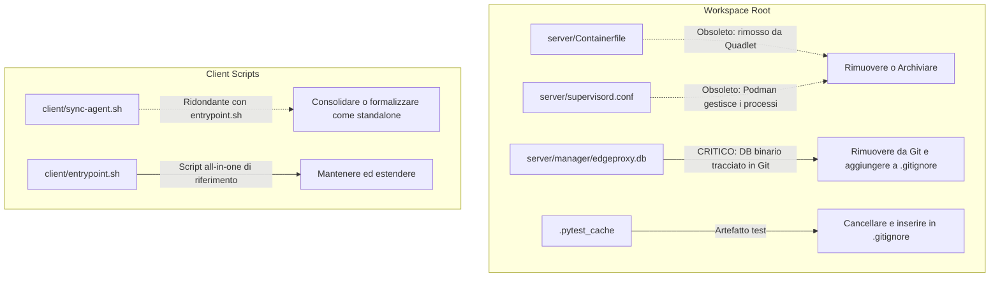
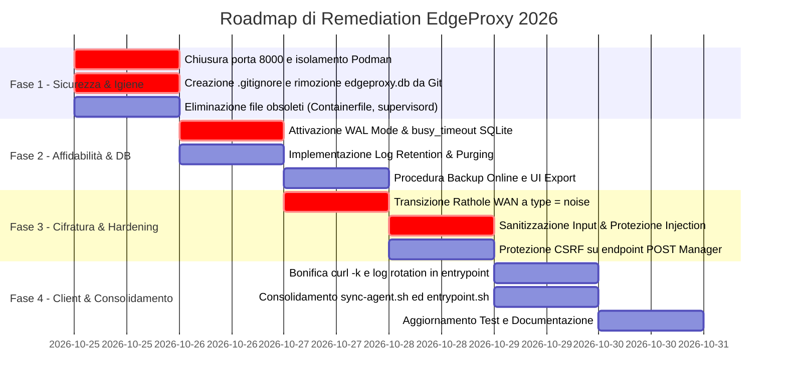

# EdgeProxy — Rapporto di Audit Tecnico, Architetturale e di Sicurezza (Revisione 2026)

> **Data Audit**: 24 Ottobre 2026  
> **Oggetto**: Repository EdgeProxy, Stack Podman Quadlet, Web Manager FastAPI, Reverse Proxy Caddy, Reverse Tunnel Rathole, OAuth2-Proxy e Agenti Client  
> **Autore**: Zoo — Technical Leader & Architect  
> **Stato**: Approvato per Implementazione  

---

## 1. Executive Summary & Indice di Maturità

L'architettura **EdgeProxy** rappresenta un'evoluzione architetturale volta a sostituire l'infrastruttura proprietaria Cloudflare (Cloudflare Tunnel + Cloudflare Access) con uno stack self-hosted, sovereign e altamente performante basato su **Podman Pod Nativo (Quadlet)** su VPS con IPv4 pubblico, unito a un client reverse tunnel sul backend privato protetto da NAT/firewall.

La transizione recente dall'iniziale stack Authelia a **Google OAuth2** orchestrato via [`quay.io/oauth2-proxy/oauth2-proxy`](server/quadlet/oauth2-proxy.container:10) e [`caddy:alpine`](server/quadlet/caddy.container:10) ha snellito notevolmente la superficie operativa. Tuttavia, l'analisi rigorosa del codice sorgente, delle unità Quadlet, degli script di deployment e dei meccanismi di persistenza ha fatto emergere **criticità architetturali e di sicurezza ad alto impatto**, che richiedono interventi immediati prima dell'adozione definitiva in produzione.

### Security & Operational Maturity Scorecard

```
+-----------------------------------------------------------------------+
| Metrica                       | Score  | Stato      | Valutazione     |
+-----------------------------------------------------------------------+
| Isolamento Rete & Porte       | 50/100 | ALLARME    | Critico         |
| Crittografia Transport WAN    | 40/100 | ALLARME    | Critico         |
| Robustezza Input & Injection  | 55/100 | ATTENZIONE | Rischio Elevato |
| Gestione Database & Storage   | 60/100 | ATTENZIONE | Rischio Lock/Cap|
| Disaster Recovery & Backup    | 30/100 | CRITICO    | Inesistente     |
| Igiene Repository & Git       | 45/100 | ALLARME    | Debito Tecnico  |
| Resilienza Client Autonomo    | 75/100 | BUONO      | Perfezionabile  |
+-----------------------------------------------------------------------+
| PUNTEGGIO COMPLESSIVO         | 51/100 | LIVELLO DI MATURITÀ: MEDIO-BASSO |
+-----------------------------------------------------------------------+
```

---

## 2. Inventario File, Pulizia Debito Tecnico e Analisi Residui

Un repository pulito e privo di file non tracciati o ridondanti è il primo requisito di sicurezza e manutenibilità. La scansione ha identificato le seguenti anomalie strutturali:



### 2.1 File Obsoleti da Rimuovere
1. **[`server/Containerfile`](server/Containerfile:1)**:
   - *Diagnosi*: Costruisce un'immagine monolitica All-in-One basata su Alpine contenente Caddy, OAuth2-Proxy, Rathole e Supervisord.
   - *Stato Corrente*: La produzione su VPS utilizza il Podman Pod nativo orchestrato tramite file Quadlet ([`server/quadlet/edgeproxy.pod`](server/quadlet/edgeproxy.pod:1)), che scarica e gestisce separatamente le immagini ufficiali ultra-leggere (`docker.io/caddy:alpine`, `quay.io/oauth2-proxy/oauth2-proxy:latest`, `docker.io/rapiz1/rathole:latest`, `docker.io/library/python:3.12-alpine`).
   - *Rischio*: Genera confusione per gli sviluppatori, richiede tempi di build superflui ed espone a disallineamenti di configurazione.
   - *Azione Raccomandata*: **Rimuovere definitivamente** [`server/Containerfile`](server/Containerfile:1).

2. **[`server/supervisord.conf`](server/supervisord.conf:1)**:
   - *Diagnosi*: File di configurazione per `supervisord`, utilizzato unicamente all'interno del vecchio `server/Containerfile`.
   - *Stato Corrente*: Il ciclo di vita, i restart e lo streaming unificato dei log sono ora interamente gestiti da **systemd** e **Podman Quadlet** nativi.
   - *Azione Raccomandata*: **Rimuovere definitivamente** [`server/supervisord.conf`](server/supervisord.conf:1).

3. **[`.pytest_cache/`](.pytest_cache)**:
   - *Diagnosi*: Directory di cache generata da pytest lasciata nella radice del repository.
   - *Azione Raccomandata*: **Cancellare** e aggiungere a [`.gitignore`](.gitignore).

### 2.2 Il Caso Critico di [`server/manager/edgeproxy.db`](server/manager/edgeproxy.db) e Assenza di [`.gitignore`](.gitignore)
- **Diagnosi**: Nel repository manca completamente il file [`.gitignore`](.gitignore). Di conseguenza, il file binario del database SQLite [`server/manager/edgeproxy.db`](server/manager/edgeproxy.db) è tracciato e presente nel working tree.
- **Perché NON deve MAI essere tracciato**:
  1. *Sovrascrittura Dati di Produzione*: Nello script [`deploy-vps.sh`](deploy-vps.sh:162) e [`scripts/remote-deploy.sh`](scripts/remote-deploy.sh:238), il codice esegue `cp -r "${SRC_SERVER}/manager/"* "${TARGET_SERVER_DIR}/manager/"`. Se il file `edgeproxy.db` è presente nel pacchetto locale o nel repository git, **il database di produzione viene sovrascritto**, provocando la cancellazione immediata di tutti gli host, token e configurazioni vive dell'utente. Questo evento si è già verificato storicamente (cfr. [`memory-bank/activeContext.md`](memory-bank/activeContext.md:12)).
  2. *Inquinamento del Repository*: Ogni run locale o test genera modifiche binarie continue su Git, gonfiando la cronologia del repository senza valore semantico.
  3. *Esposizione Segreti*: Il DB locale può contenere token Rathole o chiavi di test/produzione che non devono essere storicizzati nel control versioning.
- **Azione Raccomandata**:
  1. Creare immediatamente un file [`.gitignore`](.gitignore) contenente:
     ```gitignore
     *.db
     *.db-wal
     *.db-shm
     *.sqlite3
     .env
     server/.env
     client/.env
     __pycache__/
     *.py[cod]
     .pytest_cache/
     .venv/
     logs/
     *.log
     access.jsonl
     ```
  2. Rimuovere `edgeproxy.db` dal tracciamento git con `git rm --cached server/manager/edgeproxy.db`.
  3. Modificare [`deploy-vps.sh`](deploy-vps.sh:162) per escludere esplicitamente la sovrascrittura di file `*.db` se già esistenti su `${TARGET_SERVER_DIR}/manager/`.

### 2.3 Analisi dei Test: `tests/test_caddyfile` e [`tests/test_manager.py`](tests/test_manager.py)
- **`tests/test_caddyfile`**: Non è presente nel repository; la validazione sintattica ufficiale di Caddy è affidata correttamente allo script con container effimero [`tests/validate_configs.sh`](tests/validate_configs.sh:10).
- **[`tests/test_manager.py`](tests/test_manager.py:1)**:
  - L'audit approfondito conferma che la suite di test è stata interamente bonificata da Authelia/TOTP.
  - La suite verifica accuratamente:
    * La dashboard e il rendering HTML ([`TestEdgeProxyManager.test_01_dashboard_view`](tests/test_manager.py:56)).
    * L'assegnazione automatica di porte e token ([`TestEdgeProxyManager.test_02_add_host_and_port_assignment`](tests/test_manager.py:65)).
    * La generazione dinamica del Caddyfile con blocco di Google OAuth e l'esclusione di Authelia ([`TestEdgeProxyManager.test_03_caddyfile_generation`](tests/test_manager.py:125)).
    * L'ingestione incrementale dei log e il tracciamento della banda ([`TestEdgeProxyManager.test_08_access_log_ingestion`](tests/test_manager.py:192)).
    * La riconciliazione delle configurazioni all'avvio ([`TestEdgeProxyManager.test_12_startup_reconciliation_logic`](tests/test_manager.py:382)).
  - *Miglioramento consigliato*: Aggiungere asserzioni che verifichino la sanitizzazione dell'input contro directive injection.

### 2.4 Ridondanza Client: [`client/sync-agent.sh`](client/sync-agent.sh) vs [`client/entrypoint.sh`](client/entrypoint.sh)
- **Diagnosi**:
  * [`client/entrypoint.sh`](client/entrypoint.sh:1) è lo script autonomo integrato nel nuovo container All-in-One ([`client/Containerfile`](client/Containerfile:1) + [`client/quadlet/edgeproxy-client.container`](client/quadlet/edgeproxy-client.container:1)). Si occupa di: avviare Rathole, poller ogni 15s su `/api/v1/client/config`, diff e ricarica trasparente di Rathole, invio telemetria e log a `/api/v1/client/report`.
  * [`client/sync-agent.sh`](client/sync-agent.sh:1) implementa sostanzialmente la stessa identica logica (download config, diffing, notifica Rathole, invio report) ma progettata per installazione bare-metal tramite timer systemd (`--install-systemd`).
- **Problema**: La duplicazione di oltre 200 righe di bash comporta il rischio che fix di sicurezza (es. sanitizzazione parametri, transizione a Noise, rimozione del flag `-k` da `curl`) vengano applicati a uno solo dei due componenti.
- **Risoluzione Raccomandata**:
  * Mantenere [`client/entrypoint.sh`](client/entrypoint.sh) come **standard architetturale primario**.
  * Trasformare [`client/sync-agent.sh`](client/sync-agent.sh) in una semplice CLI ausiliaria oppure dichiararlo formalmente come modalità standalone opzionale, condividendo una funzione comune o sincronizzandone le patch.

---

## 3. Tabella Sinottica delle Debolezze e Criticità

| ID | Severità | Area | Componente / File | Descrizione Criticità | Impatto Operativo / Sicurezza |
| :--- | :--- | :--- | :--- | :--- | :--- |
| **SEC-01** | **CRITICO** | Sicurezza Rete | [`server/quadlet/edgeproxy.pod`](server/quadlet/edgeproxy.pod:13) | **Esposizione pubblica porta 8000** su `0.0.0.0:8000` (FastAPI Web GUI). | Bypass totale di Caddy e Google OAuth: un utente esterno su internet accede al Manager, visualizza host e ruba segreti. |
| **SEC-02** | **CRITICO** | Sicurezza / Injection | [`server/manager/config_engine.py`](server/manager/config_engine.py:193), [`server/manager/app.py`](server/manager/app.py:152) | **Caddyfile & TOML Directive Injection**: mancanza di validazione FQDN e caratteri di controllo su `domain`, `allowed_emails`, `service_token`. | Possibilità di iniettare direttive arbitrarie in Caddyfile (esposizione filesystem, proxy rogue, crash del parser Caddy o Rathole). |
| **OPS-01** | **CRITICO** | Integrità Dati | [`server/manager/edgeproxy.db`](server/manager/edgeproxy.db), [`deploy-vps.sh`](deploy-vps.sh:162), [`.gitignore`](.gitignore) | **Tracciamento DB SQLite in git e sovrascrittura in deploy**: assenza di `.gitignore` e `cp -r` distruttivo. | Perdita irreversibile degli host configurati e dei token di produzione durante gli aggiornamenti via deploy script. |
| **SEC-03** | **ALTO** | Crittografia WAN | [`server/rathole/server.toml`](server/rathole/server.toml:9), [`client/rathole/client.toml`](client/rathole/client.toml:10) | **Tunnel Rathole WAN in chiaro**: `type = "tcp"` su porta internet pubblica 2333. | Sniffing e intercettazione in transito di tutti i dati HTTP non cifrati scambiati tra backend locale e VPS attraverso la rete pubblica. |
| **SEC-04** | **ALTO** | Sicurezza Web | [`server/manager/app.py`](server/manager/app.py:150) | **Assenza di protezione CSRF** su tutti gli endpoint POST (`/hosts/add`, `/delete`, `/settings`, `/sync`). | Un amministratore autenticato che visita una pagina malevola può subire richieste cross-site forzate che cancellano o alterano host. |
| **OPS-02** | **ALTO** | Affidabilità DB | [`server/manager/db.py`](server/manager/db.py:19) | **Mancanza di WAL Mode e `busy_timeout` in SQLite**: lock esclusivo di default con 4 worker concorrenti. | Errori bloccanti `sqlite3.OperationalError: database is locked` a causa di scritture simultanee di `stats.py`, `linkmon.py` e report client. |
| **OPS-03** | **ALTO** | Resilienza Disco | [`server/manager/stats.py`](server/manager/stats.py:137), [`server/manager/db.py`](server/manager/db.py:75) | **Assenza di retention policy nel DB per `access_logs` e `client_reports`**: accumulo infinito. | Saturazione incontrollata dello spazio disco della VPS; `edgeproxy.db` cresce indefinitamente fino a bloccare il server. |
| **SEC-05** | **MEDIO** | Integrità Client | [`client/entrypoint.sh`](client/entrypoint.sh:87), [`client/sync-agent.sh`](client/sync-agent.sh:53) | **Uso del flag `curl -k` (Insecure TLS)** nel poller del client verso il Manager. | Vulnerabilità ad attacchi Man-In-The-Middle sulla LAN/WAN locale con potenziale iniezione di configurazioni alterate o intercettazione token. |
| **OPS-04** | **MEDIO** | Disaster Recovery | [`server/manager/db.py`](server/manager/db.py:1) | **Assenza di meccanismo di backup online per SQLite** (`VACUUM INTO` / `sqlite3.backup`). | Impossibilità di ripristinare il sistema in caso di guasto hardware o cancellazione accidentale se non riconfigurando manualmente gli host. |
| **CODE-01** | **MEDIO** | Risorse Client | [`client/entrypoint.sh`](client/entrypoint.sh:50) | **Crescita illimitata del file `/tmp/rathole.log`** nel container senza troncamento o rotazione. | Rischio di esaurimento memoria RAM (tmpfs) o storage locale nel tempo sui client attivi continuamente per mesi. |
| **CODE-02** | **MEDIO** | Resilienza Routing | [`server/manager/config_engine.py`](server/manager/config_engine.py:14) | **Collisione in `clean_service_name`** su sottodomini omonimi (`app.a.com` vs `app.b.com`). | Rathole Server fallisce il caricamento del TOML per duplicazione delle sezioni `[server.services.<name>]`. |
| **CODE-03** | **MEDIO** | Manutenibilità | [`client/sync-agent.sh`](client/sync-agent.sh), [`client/entrypoint.sh`](client/entrypoint.sh) | **Duplicazione della logica di polling e telemetria** tra due script bash indipendenti. | Rischio di divergenze comportamentali durante patch evolutive o di sicurezza. |
| **SEC-06** | **BASSO** | Hardening Log | [`server/caddy/Caddyfile`](server/caddy/Caddyfile:8), [`server/manager/config_engine.py`](server/manager/config_engine.py:110) | **Assenza di `roll_keep_days`** nella configurazione di rotazione log di Caddy. | Conservazione di log vecchi oltre i limiti temporali auspicati di compliance/privacy se il volume di traffico è ridotto. |
| **OPS-05** | **BASSO** | Monitoraggio | [`client/quadlet/edgeproxy-client.container`](client/quadlet/edgeproxy-client.container:1) | **Assenza di direttiva `HealthCmd`** nei container Quadlet di produzione. | Systemd/Podman non è a conoscenza dello stato di salute effettivo del tunnel o dell'ingestore se il processo rimane in stallo. |

---

## 4. Analisi Dettagliata delle Aree e Risposte ai Quesiti

### 4.1 Audit di Sicurezza e Controllo Accessi

#### 4.1.1 Esposizione Porta 8000 in [`server/quadlet/edgeproxy.pod`](server/quadlet/edgeproxy.pod:13)
- **Meccanica del Rischio**:
  La riga `PublishPort=8000:8000/tcp` dice a Podman di esporre la porta 8000 su tutte le interfacce (`0.0.0.0`). Chiunque conosca l'indirizzo IP pubblico della VPS può navigare su `http://<IP-VPS>:8000/` e interagire con il Manager FastAPI.
  FastAPI non dispone di un layer di autenticazione interno basato su password: la sicurezza dell'interfaccia si basa interamente sul reverse proxy Caddy con lo snippet `import google_auth` presente su `manager.{$DOMAIN}`. Pubblicando la porta 8000 sull'interfaccia WAN, **tutte le protezioni di Google OAuth2 vengono scavalcate istantaneamente**.
- **Soluzione Architetturale**:
  In un Podman Pod nativo, tutti i container nel pod ([`caddy`](server/quadlet/caddy.container), [`manager`](server/quadlet/manager.container), [`rathole`](server/quadlet/rathole.container), [`oauth2-proxy`](server/quadlet/oauth2-proxy.container)) condividono lo stesso stack di rete (`network_mode="share"` / `localhost`). Caddy parla con il Manager indirizzando `127.0.0.1:8000` all'interno del pod, senza alcun bisogno di pubblicare la porta verso l'esterno.
  **Azione**: Rimuovere `PublishPort=8000:8000/tcp` da [`server/quadlet/edgeproxy.pod`](server/quadlet/edgeproxy.pod). Le uniche porte pubblicate devono essere `80:80/tcp`, `443:443/tcp`, `443:443/udp` (Caddy HTTP/HTTPS/QUIC) e `2333:2333/tcp` (Rathole).

#### 4.1.2 Crittografia WAN Rathole: Transizione Sicura da TCP a Noise Protocol
- **Stato Attuale**:
  [`server/rathole/server.toml`](server/rathole/server.toml:9) e [`client/rathole/client.toml`](client/rathole/client.toml:10) hanno `type = "tcp"`. Questo significa che il multiplexing di tutti i servizi locali verso la VPS transita in chiaro. Se un servizio come KasmVNC, Home Assistant o Jellyfin espone risorse HTTP o cookie, questi sono intercettabili da chiunque si trovi sul percorso di rete (ISP, transito, reti Wi-Fi pubbliche).
- **Come effettuare la transizione a `type = "noise"` in totale sicurezza**:
  Rathole supporta nativamente la suite `Noise_NN_25519_ChaChaPoly_BLAKE2s` (handshake crittografico con curve 25519 e cifratura ChaCha20-Poly1305, autenticato dal token di servizio) o `Noise_NK` (con chiave asimmetrica nota).
  Poiché il client preleva la configurazione via HTTPS tramite Caddy (`https://auth.edge.mpv.cx/api/v1/client/config`), il canale di controllo è indipendente dal tunnel Rathole.
  *Procedura di Rollout Zero-Downtime / Zero-Lockout*:
  1. Aggiornare il database SQLite del Manager impostando `rathole_transport = 'noise'`.
  2. Il Manager riscrive atomicamente [`server.toml`](server/rathole/server.toml) con:
     ```toml
     [server.transport]
     type = "noise"
     [server.transport.noise]
     pattern = "Noise_NN_25519_ChaChaPoly_BLAKE2s"
     ```
  3. Il Manager ricarica/riavvia Rathole Server (`systemctl restart rathole.service`).
  4. Entro i successivi 15 secondi, il client locale scarica il nuovo `client.toml` generato con:
     ```toml
     [client.transport]
     type = "noise"
     [client.transport.noise]
     pattern = "Noise_NN_25519_ChaChaPoly_BLAKE2s"
     ```
  5. [`client/entrypoint.sh`](client/entrypoint.sh:125) rileva la differenza di hash nel file, invia SIGTERM e rilancia Rathole Client.
  6. Il client stabilisce la connessione cifrata Noise; il canale è protetto al 100%.

#### 4.1.3 Sanitizzazione Input e Directive Injection Risk
- **Vulnerabilità**:
  In [`server/manager/config_engine.py`](server/manager/config_engine.py:193):
  ```python
  lines.append(f"{domain} {{")
  ```
  Se un utente o un'API malformata inserisce:
  `domain = "test.mpv.cx {\n  respond \"Hacked\" 200\n}\nmalicious.mpv.cx"`
  il generatore scriverà direttamente il testo all'interno di `/etc/caddy/Caddyfile`.
  Allo stesso modo, in [`config_engine.py`](server/manager/config_engine.py:210):
  ```python
  lines.append(f'\t@no_token not header X-EdgeProxy-Token "{token_val}"')
  ```
  Un token contenente doppi apici e newline può alterare la sintassi del blocco Caddy.
- **Remediation**:
  1. Introdurre validazione FQDN tramite espressione regolare RFC 1123 prima del salvataggio nel database:
     `^[a-zA-Z0-9]([a-zA-Z0-9\-]{0,61}[a-zA-Z0-9])?(\.[a-zA-Z0-9]([a-zA-Z0-9\-]{0,61}[a-zA-Z0-9])?)+$`
  2. Rifiutare qualsiasi carattere al di fuori di lettere, numeri, punti e trattini per i domini.
  3. Sanitizzare i token e le email eliminando qualsiasi carattere di a capo (`\r`, `\n`) e delimitatori Caddy (`{`, `}`, `"`, `;`).
  4. In [`config_engine.py`](server/manager/config_engine.py:14), modificare [`clean_service_name`](server/manager/config_engine.py:14) affinché includa un digest o la combinazione di dominio e porta (es. `f"{clean_part}_{port}"`), impedendo collisioni tra `service.domain1.com` e `service.domain2.com`.

#### 4.1.4 Protezione CSRF (Cross-Site Request Forgery)
- **Diagnosi**:
  I cookie di Google OAuth emessi da `oauth2-proxy` (`_oauth2_proxy`) proteggono la sessione HTTP, ma non impediscono l'invio di form HTML o fetch da siti terzi se l'attributo `SameSite` non è vincolante o se un sito malevolo sfrutta una navigazione di tipo top-level. Inoltre, il backend FastAPI elabora i comandi di aggiunta o eliminazione degli host senza verificare un token CSRF e senza validare l'header HTTP `Origin` o `Referer`.
- **Remediation**:
  1. Aggiungere in [`server/manager/app.py`](server/manager/app.py) un middleware o una dependency per la verifica dell'header `Origin`/`Referer`: per ogni richiesta `POST`, verificare che l'origine corrisponda esattamente all'host del Manager.
  2. Implementare token CSRF (Double Submit Cookie o generato da FastAPI e inserito nei form con `<input type="hidden" name="csrf_token" value="...">`).

---

### 4.2 Audit di Affidabilità e Resilienza Operativa

#### 4.2.1 Concorrenza SQLite e WAL Mode
- **Il Problema**:
  Attualmente [`server/manager/db.py`](server/manager/db.py:17) si connette a SQLite con i parametri di default:
  ```python
  conn = sqlite3.connect(DB_PATH)
  ```
  La modalità predefinita di SQLite è `journal_mode = DELETE`. In questa modalità:
  * Quando un processo scrive sul database, viene acquisito un lock esclusivo sull'intero file.
  * Nessun lettore può accedere al database mentre una scrittura è in corso.
  Nel nostro stack sono presenti contemporaneamente:
  1. **Uvicorn / FastAPI**: risponde alle richieste web degli utenti su diverse route concorrenti.
  2. **[`stats.py`](server/manager/stats.py:234)**: effettua cicli di ingestione log ogni 5 secondi, scrivendo centinaia di record in `access_logs` e `bandwidth_stats`.
  3. **[`linkmon.py`](server/manager/linkmon.py:148)**: task in background ogni 10 secondi che aggiorna lo stato dei link di ciascun host in `hosts`.
  4. **Client Heartbeat**: ogni 15 secondi il client invia un report telemetrico a `/api/v1/client/report`, scatenando un `INSERT` in `client_reports`.
  In presenza di traffico HTTP sostenuto, i conflitti tra scrittori e lettori sfociano regolarmente in eccezioni `sqlite3.OperationalError: database is locked`.
- **Risoluzione Immediata**:
  Configurare in [`server/manager/db.py`](server/manager/db.py:17) la connessione SQLite per attivare **WAL (Write-Ahead Logging)** e timeout:
  ```python
  def get_db_connection() -> sqlite3.Connection:
      os.makedirs(os.path.dirname(os.path.abspath(DB_PATH)), exist_ok=True)
      conn = sqlite3.connect(DB_PATH, timeout=10.0)
      conn.row_factory = sqlite3.Row
      conn.execute("PRAGMA journal_mode = WAL;")
      conn.execute("PRAGMA busy_timeout = 10000;")
      conn.execute("PRAGMA synchronous = NORMAL;")
      return conn
  ```
  *Vantaggi*: In modalità WAL, i lettori non bloccano gli scrittori e gli scrittori non bloccano i lettori. Le letture avvengono in parallelo senza alcuna contesa, garantendo stabilità assoluta.

#### 4.2.2 Rischio Saturazione Disco e Retention Log
- **Stato Caddy**: Caddyfile ha configurato:
  ```caddy
  roll_size 50mb
  roll_keep 3
  ```
  Questo limita la dimensione dei log di testo su disco a un massimo teorico di ~200MB. Per una corretta pulizia temporale, è opportuno aggiungere `roll_keep_days 7`.
- **La Vera Criticità: Il Database SQLite**:
  [`stats.py`](server/manager/stats.py:137) legge `access.jsonl` ed esegue un `INSERT` per ogni singola richiesta HTTP nella tabella `access_logs`.
  Inoltre, il client invia un heartbeat ogni 15s salvato in `client_reports`.
  **Non esiste alcuna operazione di cancellazione o purging nel database!**
  *Stima di crescita*: Con soli 10 hit al secondo, vengono scritti 864.000 record al giorno in `access_logs` (~150MB di SQLite al giorno = ~4.5GB al mese). In pochi mesi, la partizione `/opt` della VPS si saturerà, bloccando Caddy, Rathole e il sistema operativo.
- **Remediation**:
  Implementare un worker di retention in [`stats.py`](server/manager/stats.py) che esegua periodicamente (es. ogni notte o ogni ora):
  ```sql
  DELETE FROM access_logs WHERE timestamp < datetime('now', '-14 days');
  DELETE FROM client_reports WHERE timestamp < datetime('now', '-7 days');
  ```
  Eseguire periodicamente `PRAGMA incremental_vacuum;` (avendo abilitato `PRAGMA auto_vacuum = INCREMENTAL;`).

#### 4.2.3 Backup e Disaster Recovery per `edgeproxy.db`
- **Stato Attuale**: Completamente assente.
- **Implementazione Raccomandata**:
  1. Aggiungere una funzione in [`server/manager/db.py`](server/manager/db.py) che utilizzi l'API online sicura di SQLite:
     ```python
     def backup_db(backup_dir: str = "/opt/edgeproxy/server/backups") -> str:
         os.makedirs(backup_dir, exist_ok=True)
         timestamp = datetime.now(timezone.utc).strftime("%Y%m%d_%H%M%S")
         backup_file = os.path.join(backup_dir, f"edgeproxy_backup_{timestamp}.db")
         with get_db_connection() as src_conn:
             with sqlite3.connect(backup_file) as dst_conn:
                 src_conn.backup(dst_conn)
         # Mantieni solo gli ultimi 7 backup
         # ... rotazione file vecchi ...
         return backup_file
     ```
  2. Esportazione/Importazione Web: Creare un endpoint GET `/api/v1/system/backup` protetto e un pulsante "Scarica Snapshot Configurazione" nella schermata `Settings` per permettere il download istantaneo del database o di un dump JSON.

---

### 4.3 Audit del Client Locale

#### 4.3.1 Robustezza di [`client/entrypoint.sh`](client/entrypoint.sh)
- **Aspetti Positivi Riscontrati**:
  * Utilizzo di `trap cleanup SIGTERM SIGINT` per propagare correttamente lo shutdown a Rathole e processi accessori.
  * Verifica dell'integrità del file scaricato (`grep -q "\[client\]"`) prima di sovrascrivere `client.toml`.
  * Riavvio automatico del processo Rathole in caso di crash accidentale (`kill -0`).
- **Punti Deboli Rilevati**:
  1. **Uso di `curl -k` (Insecure TLS)**: L'opzione `-k` disabilita la convalida del certificato SSL di Caddy. Se un attaccante esegue ARP spoofing o DNS poisoning sulla rete locale del client, può intercettare il token di sync ed esporre le configurazioni interne. Occorre rimuovere `-k` e affidarsi ai certificati CA attendibili (già installati nell'immagine Alpine tramite `ca-certificates`).
  2. **Accumulo Log `/tmp/rathole.log`**: Rathole redirige stdout/stderr su `/tmp/rathole.log` tramite `>> /tmp/rathole.log 2>&1`. Se il container gira ininterrottamente per mesi, il file cresce all'infinito. È necessario implementare una rotazione/troncamento (es. limitare il log alle ultime 5000 righe tramite `tail -n 2000` periodico).
  3. **DNS Stale Caching di Rathole**: Se la VPS cambia IP pubblico o la connessione internet WAN cade a lungo, Rathole potrebbe fallire la riconnessione finché non viene rilanciato il processo. È opportuno introdurre una verifica di fallimento consecutivo dei tentativi di connessione per forzare un rilancio completo del processo.

---

## 5. Piano di Remediation Concreto e Prioritizzato



### Fase 1: Sicurezza Immediata e Igiene del Repository (Priorità Massima)
1. **Chiusura Porta 8000**: Modificare [`server/quadlet/edgeproxy.pod`](server/quadlet/edgeproxy.pod:13), eliminando la riga `PublishPort=8000:8000/tcp`. Il Manager sarà raggiungibile esclusivamente tramite il reverse proxy Caddy all'indirizzo `https://manager.<DOMAIN>` sotto protezione Google OAuth2.
2. **Creazione [`.gitignore`](.gitignore)**: Aggiungere il file `.gitignore` per escludere file binari SQLite, `.env`, `.pytest_cache/`, `__pycache__/`, `.venv/` e file di log.
3. **Rimozione DB da Git**: Eseguire `git rm --cached server/manager/edgeproxy.db` e rimuovere la cartella residua `.pytest_cache/`.
4. **Rimozione Debito Tecnico Obsoleto**: Eliminare [`server/Containerfile`](server/Containerfile:1) e [`server/supervisord.conf`](server/supervisord.conf:1).
5. **Protezione Deploy Script**: Modificare [`deploy-vps.sh`](deploy-vps.sh:162) affinché non sovrascriva mai `edgeproxy.db` se già presente sul server di destinazione.

### Fase 2: Robustezza Storage, Concorrenza e Disaster Recovery
1. **SQLite WAL Mode**: Modificare [`server/manager/db.py`](server/manager/db.py:17) per attivare `PRAGMA journal_mode=WAL;`, `PRAGMA busy_timeout=10000;` e `PRAGMA synchronous=NORMAL;`.
2. **Log Retention Worker**: Aggiungere in [`server/manager/stats.py`](server/manager/stats.py) una routine asincrona di pulizia per eliminare i record di `access_logs` più vecchi di 14 giorni e i report client oltre i 7 giorni.
3. **Snapshot di Backup Online**: Implementare in [`server/manager/db.py`](server/manager/db.py) la procedura di snapshot atomico tramite `sqlite3.backup()` con rotazione locale su 7 copie, integrando un endpoint di download nella schermata impostazioni.

### Fase 3: Hardening Crittografico WAN, Sanitizzazione Input e CSRF
1. **Transizione a Rathole Noise Protocol**:
   - Impostare `rathole_transport = 'noise'` in [`server/manager/config_engine.py`](server/manager/config_engine.py:299) e nel database.
   - Rigenerare contemporaneamente `server.toml` e `client.toml`.
   - Riavviare il servizio Rathole server e verificare che il client si allinei in Noise entro 15 secondi senza interruzioni operative.
2. **Validazione FQDN e Anti-Injection**:
   - Introdurre validatori rigorosi con regex RFC 1123 in [`server/manager/app.py`](server/manager/app.py:150) e [`server/manager/config_engine.py`](server/manager/config_engine.py:180).
   - Sanitizzare apici e newline nei campi `service_token` e `allowed_emails`.
   - Normalizzare i nomi dei servizi Rathole aggiungendo la porta per prevenire collisioni.
3. **Protezione CSRF**:
   - Aggiungere controllo dell'header `Origin` o token CSRF per tutte le richieste POST verso il Manager in [`server/manager/app.py`](server/manager/app.py).

### Fase 4: Resilienza Client e Test di Validazione
1. **Hardening del Client**:
   - Rimuovere il flag `-k` da `curl` in [`client/entrypoint.sh`](client/entrypoint.sh:87) e [`client/sync-agent.sh`](client/sync-agent.sh:53).
   - Introdurre un meccanismo di rotazione/troncamento per `/tmp/rathole.log`.
2. **Consolidamento Script Client**: Sincronizzare la logica di [`client/sync-agent.sh`](client/sync-agent.sh) con [`client/entrypoint.sh`](client/entrypoint.sh).
3. **Test di Regressione Completi**:
   - Eseguire [`tests/validate_configs.sh`](tests/validate_configs.sh) con Caddy.
   - Eseguire [`tests/test_manager.py`](tests/test_manager.py) con container effimero Python per validare la nuova configurazione.

---

## 6. Conclusioni dell'Audit

Lo stack architetturale EdgeProxy è concettualmente eccellente e moderno: la combinazione di Caddy (con certificati automatici e HTTP/3), OAuth2-Proxy (con Google OAuth2) e Rathole (con reverse tunnel ad altissimo throughput) offre un'alternativa sovereign formidabile a Cloudflare.

L'adozione delle misure correttive pianificate risolverà le ultime debolezze strutturali, elevando il livello di sicurezza a standard enterprise, garantendo concorrenza database impeccabile e proteggendo i dati dell'infrastruttura contro qualsiasi perdita accidentale.
