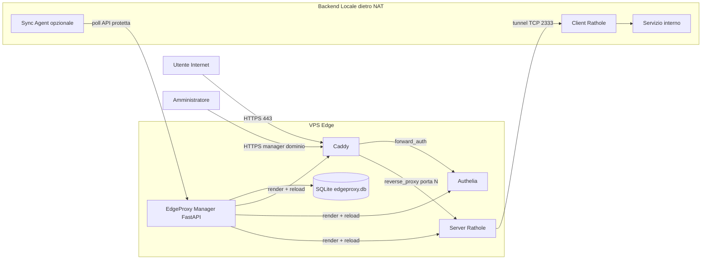
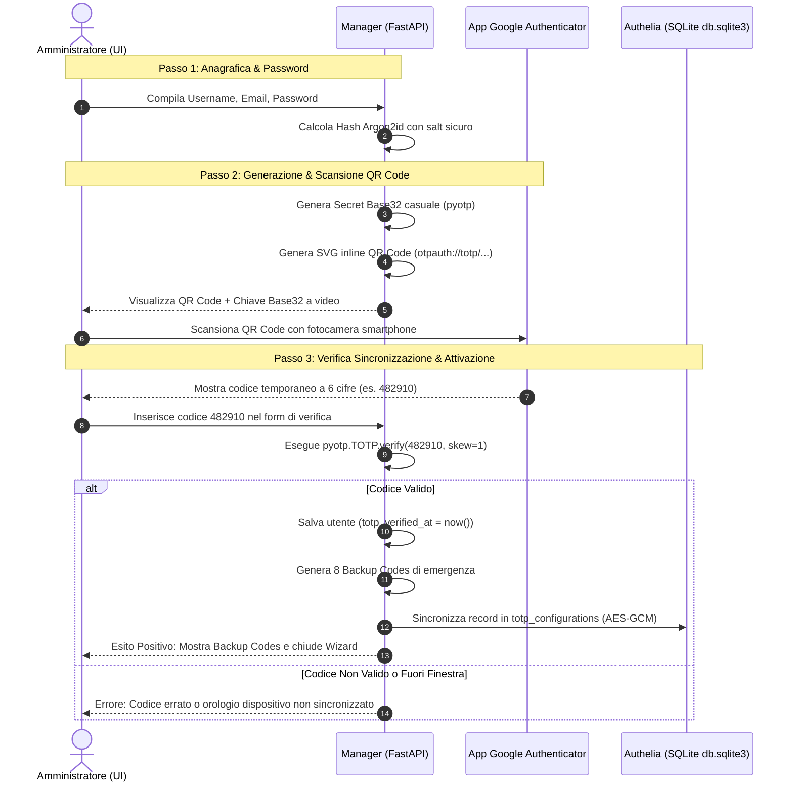
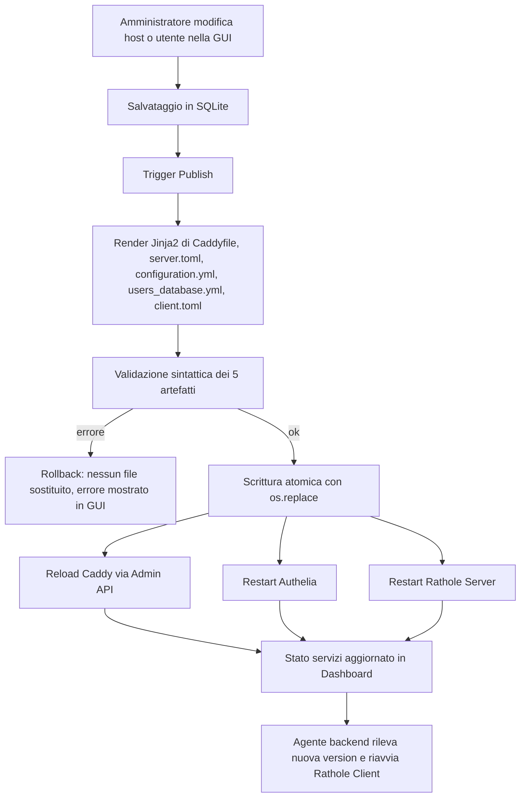

# EdgeProxy Manager — Specifica Architetturale (Control Plane)

> **Stato**: Progettazione architetturale (nessun codice implementativo).
> **Direttiva**: "Progetta una soluzione" per la gestione centralizzata dell'intero stack EdgeProxy.
> **Stack confermato**: Python **FastAPI** + **SQLite** (single source of truth) + **Jinja2** (config engine) + frontend **HTML/Tailwind con HTMX** (monolitico, leggero, semplice da containerizzare).
> Questo documento è la sorgente di verità per la successiva fase di implementazione.

---

## 1. Obiettivo del Control Plane

Dotare EdgeProxy di una **Web GUI / Dashboard** unica che permetta, senza modificare manualmente i file, di:

1. Definire la **sinergia domini → backend** (es. `pippo.knob.it` → `https://10.88.0.100:9443`), con supporto HTTP e HTTPS, inclusi certificati interni/self-signed sul backend.
2. Gestire in modo **centralizzato** credenziali, utenti, gruppi e autenticazione **TOTP Google Authenticator**.
3. **Generare e sincronizzare** in modo coerente le configurazioni di **Caddy**, **Authelia** e **Rathole** (server e client).
4. Esporre la GUI stessa in modo **sicuro** (dietro 2FA/autenticazione master).

La base dati locale **SQLite** diventa l'unica **Single Source of Truth**: ogni file di configurazione dei tre componenti è **derivato** dai dati e non deve mai essere modificato a mano.

---

## 2. Posizionamento e Stack Tecnologico

### 2.1 Collocazione nel repository

Il Manager è un servizio integrato dello stack VPS, quindi vive dentro [`server/`](server/) e viene orchestrato insieme a Caddy, Authelia e Rathole nell'immagine All-in-One e gestito tramite [`server/quadlet/edgeproxy-server.container`](server/quadlet/edgeproxy-server.container).

```text
server/
├── manager/
│   ├── Containerfile                 # immagine FastAPI minimale
│   ├── app/
│   │   ├── main.py                   # bootstrap FastAPI, lifespan, routers
│   │   ├── db.py                     # SQLite + SQLAlchemy (o sqlite3) + migrazioni
│   │   ├── models.py                 # ORM/entity hosts, users, settings, tokens, audit
│   │   ├── schemas.py                # Pydantic input/output
│   │   ├── security.py               # Argon2id, TOTP, token API, sessioni
│   │   ├── config_engine.py          # orchestrazione generazione atomica + reload
│   │   ├── render.py                 # helper Jinja2 (config + pagine)
│   │   └── routers/
│   │       ├── web_ui.py             # pagine HTMX (dashboard, host, users, client)
│   │       ├── hosts.py              # CRUD host
│   │       ├── users.py              # CRUD utenti + onboarding TOTP
│   │       ├── settings.py           # dominio root, ACME, segreti globali
│   │       └── sync.py               # API di distribuzione client (Modalità A/B)
│   ├── templates/
│   │   ├── base.html                 # layout Tailwind
│   │   ├── dashboard.html
│   │   ├── hosts_list.html
│   │   ├── host_form.html
│   │   ├── users_list.html
│   │   ├── user_form.html
│   │   ├── totp_enroll.html          # QR code onboarding
│   │   ├── client_config.html        # download/curl client.toml
│   │   └── config/
│   │       ├── Caddyfile.j2
│   │       ├── server.toml.j2
│   │       ├── configuration.yml.j2
│   │       ├── users_database.yml.j2
│   │       └── client.toml.j2
│   ├── static/
│   └── data/                         # volume persistente: edgeproxy.db (SQLite)
```

### 2.2 Componenti e versioni raccomandate

| Ruolo | Componente | Note |
|-------|-----------|------|
| Backend/API + rendering | FastAPI + Uvicorn | Python 3.12-slim |
| Persistenza | SQLite (file `data/edgeproxy.db`) | WAL mode, backup periodico |
| ORM/accesso dati | SQLAlchemy 2.x | oppure `sqlite3` stdlib se si preferisce zero-astrazioni |
| Config engine | Jinja2 | genera sia pagine HTML sia file di config |
| Frontend | Tailwind CSS + HTMX | zero build step, asset serviti da `/static` |
| TOTP/QR | `pyotp` + `qrcode` | onboarding Google Authenticator |
| Hash password | `argon2-cffi` | coerente con Authelia (Argon2id) |
| Riavvii container | `podman` CLI | invocato tramite socket/exec sul container `manager` |

### 2.3 Architettura logica



---

## 3. Modello Dati SQLite

### 3.1 Schema (DDL concettuale)

**`hosts`** — mappa SNI → upstream, con allocazione porta Rathole e policy di accesso.

| Colonna | Tipo | Descrizione |
|---------|------|-------------|
| `id` | INTEGER PK | identificativo |
| `slug` | TEXT UNIQUE | nome servizio Rathole, es. `pippo` |
| `sni` | TEXT UNIQUE | dominio esposto, es. `pippo.knob.it` |
| `upstream_url` | TEXT | es. `https://10.88.0.100:9443` (http/https, porta custom) |
| `tls_insecure_skip_verify` | INTEGER 0/1 | true per upstream HTTPS con cert self-signed/interno |
| `rathole_port` | INTEGER UNIQUE | porta interna allocata dal pool 8000+ |
| `rathole_token` | TEXT | token casuale di servizio Rathole |
| `access_policy` | TEXT | `bypass` oppure `two_factor` |
| `allowed_groups` | TEXT (JSON) | lista gruppi autorizzati, es. `["admins","dev"]` |
| `enabled` | INTEGER 0/1 | abilita/disabilita il vhost |
| `created_at` | TEXT | timestamp |
| `updated_at` | TEXT | timestamp |

**`users`** — credenziali, identità Authelia e provisioning Google Authenticator.

| Colonna | Tipo | Descrizione |
|---------|------|-------------|
| `id` | INTEGER PK | identificativo univoco |
| `username` | TEXT UNIQUE | login Authelia (alfanumerico minuscolo) |
| `email` | TEXT | email utente (usata anche per notifiche/recupero) |
| `display_name` | TEXT | nome visualizzato nel portale Authelia |
| `password_hash` | TEXT | hash Argon2id (generato automaticamente con parametri sicuri) |
| `totp_secret` | TEXT | chiave segreta Base32 (cifrata a riposo con chiave AES-GCM del Manager) |
| `totp_enabled` | INTEGER 0/1 | stato 2FA abilitato (1 = attivo e verificato, 0 = disabilitato) |
| `totp_verified_at` | TEXT | timestamp ISO 8601 di superamento del test iniziale a 6 cifre |
| `totp_backup_codes` | TEXT (JSON) | array di hash dei codici di emergenza monouso |
| `groups` | TEXT (JSON) | lista gruppi di autorizzazione, es. `["admins","dev"]` |
| `created_at` | TEXT | timestamp di creazione |
| `updated_at` | TEXT | timestamp di creazione/modifica |

**`settings`** — configurazione globale, segreti, protocollo TOTP e notifiche SMTP.

| Chiave | Tipo / Default | Descrizione |
|--------|----------------|-------------|
| `base_domain` | TEXT | Dominio root, es. `knob.it` |
| `acme_email` | TEXT | Email ACME per certificati Caddy (Let's Encrypt / ZeroSSL) |
| `rathole_public_port` | INTEGER (`2333`) | Porta pubblica di trasporto TCP Rathole |
| `rathole_port_pool_start` | INTEGER (`8000`) | Inizio pool porte interne per proxy dei servizi |
| `jwt_secret` | TEXT | Segreto crittografico JWT Authelia |
| `session_secret` | TEXT | Segreto crittografico sessione e cookie Authelia |
| `storage_encryption_key` | TEXT | Chiave di cifratura SQLite Authelia (`totp_configurations`) |
| `manager_host` | TEXT | SNI della Web GUI, es. `manager.knob.it` |
| `manager_protection` | TEXT (`authelia`) | Modalità di accesso: `authelia` oppure `local_master` |
| `totp_issuer` | TEXT (`EdgeProxy`) | Nome visualizzato nell'app Google Authenticator (es. "Knob Network") |
| `totp_algorithm` | TEXT (`SHA1`) | Algoritmo TOTP: `SHA1` (compatibilità Google Authenticator), `SHA256`, `SHA512` |
| `totp_period` | INTEGER (`30`) | Frequenza di rinnovo token in secondi (standard Google Authenticator: 30s) |
| `totp_digits` | INTEGER (`6`) | Lunghezza token a cifre numeriche (standard Google Authenticator: 6) |
| `totp_skew` | INTEGER (`1`) | Tolleranza temporale server-client per clock drift (+/- 1 finestra da 30s) |
| `smtp_enabled` | INTEGER (`0`) | 1 = Notifiche/validazione via email attive; 0 = Notificatore locale filesystem |
| `smtp_host` | TEXT (`""`) | Host del server SMTP (es. `smtp.mailgun.org`, `smtp.gmail.com`) |
| `smtp_port` | INTEGER (`587`) | Porta del server SMTP (587 STARTTLS, 465 TLS, 25 Plain) |
| `smtp_username` | TEXT (`""`) | Username per autenticazione SMTP |
| `smtp_password` | TEXT (`""`) | Password / API key per autenticazione SMTP (cifrata a riposo) |
| `smtp_sender` | TEXT (`""`) | Indirizzo email mittente (es. `Authelia <auth@knob.it>`) |
| `smtp_tls_mode` | TEXT (`starttls`) | Modalità cifratura trasporto SMTP: `starttls`, `tls`, `none` |

**`sync_tokens`** — credenziali per la distribuzione client (Modalità B).

| Colonna | Tipo | Descrizione |
|---------|------|-------------|
| `id` | INTEGER PK | identificativo |
| `name` | TEXT | nome del backend/agente |
| `token_hash` | TEXT | hash del token API (mai in chiaro) |
| `created_at` | TEXT | timestamp |
| `revoked` | INTEGER 0/1 | revoca |

**`audit_log`** (opzionale ma raccomandato).

| Colonna | Tipo | Descrizione |
|---------|------|-------------|
| `id` | INTEGER PK | identificativo |
| `ts` | TEXT | timestamp |
| `actor` | TEXT | utente/sistema |
| `action` | TEXT | `host.create`, `config.publish`, ... |
| `detail` | TEXT | JSON payload |

### 3.2 Regole di integrità e allocazione porta

- La porta interna Rathole viene allocata automaticamente dal pool `8001..8999` scegliendo la prima libera; la scelta è deterministica e riutilizzata in caso di modifica dello stesso host.
- `rathole_token` viene generato con `secrets.token_urlsafe(32)` alla creazione.
- `sni` e `slug` devono essere validati (hostname RFC 1123) per evitare Caddyfile/Toml malformati.
- Il campo `upstream_url` viene parsato per ricavare `scheme` (`http`/`https`), `host` e `port`; è l'input che alimenta sia il binding locale del client Rathole sia il `reverse_proxy` di Caddy.

---

## 4. Config Generation & Orchestration Engine

### 4.1 Principi generali

- Tutte le configurazioni sono **derivate** dallo stato SQLite e renderizzate con **Jinja2**.
- La generazione è **transazionale e atomica**: ogni file viene scritto su un path temporaneo (`*.tmp`) e poi spostato con `os.replace()` nella destinazione finale, per non lasciare mai file parziali durante un reload.
- Un **publish** (= rigenerazione completa e applicazione) viene eseguito solo dopo che **tutti** i template sono stati renderizzati e validati con successo.

### 4.2 Template generati

| Template Jinja2 | Output | Contenuto chiave |
|-----------------|--------|------------------|
| `Caddyfile.j2` | [`server/caddy/Caddyfile`](server/caddy/Caddyfile) | blocco globale email ACME, snippet `(authelia_auth)`, vhost `auth.{base_domain}`, vhost `manager` protetto, un blocco per ogni `hosts` con `import authelia_auth` (se `two_factor`) e `reverse_proxy rathole:{port}` |
| `server.toml.j2` | [`server/rathole/server.toml`](server/rathole/server.toml) | `[server] bind_addr 0.0.0.0:{rathole_public_port}`, una sezione `[server.services.{slug}]` per host con `token` e `bind_addr 0.0.0.0:{rathole_port}` |
| `configuration.yml.j2` | [`server/authelia/configuration.yml`](server/authelia/configuration.yml) | sessioni/cookie su `{base_domain}`, storage SQLite, blocco `totp` (issuer, algoritmo, periodo, cifre, skew), blocco `notifier` dinamico (SMTP se attivo, altrimenti filesystem) e `access_control` derivato dalle policy `bypass`/`two_factor` e dai gruppi |
| `users_database.yml.j2` | [`server/authelia/users_database.yml`](server/authelia/users_database.yml) | utenti con `displayname`, `password` Argon2id, `email`, `groups` |
| `client.toml.j2` | [`client/rathole/client.toml`](client/rathole/client.toml) | `remote_addr = {vps}:{rathole_public_port}`, `[client.services.{slug}]` con `token` e `local_addr` backend |

### 4.3 Regole di render Caddy

- Il blocco globale usa `{$ACME_EMAIL}` oppure direttamente `email {acme_email}` (scelta coerente con l'attuale [`Caddyfile`](server/caddy/Caddyfile), che usa `{$ACME_EMAIL}`).
- `auth.{base_domain}` → `reverse_proxy authelia:9091` (portale).
- `manager.{base_domain}` → protetto: se `manager_protection=authelia` applica `import authelia_auth`; se `local_master` applica il middleware di autenticazione del Manager stesso.
- Per ogni host `enabled`:
  - `two_factor`: `import authelia_auth` + `reverse_proxy rathole:{rathole_port}`.
  - `bypass`: solo `reverse_proxy rathole:{rathole_port}`.
  - Opzionale trasporto: per upstream HTTPS su Rathole non serve nulla di speciale in Caddy, perché il tunnel trasporta il flusso TCP/TLS end-to-end verso il backend.

### 4.4 Regole di render Authelia `access_control`

```yaml
access_control:
  default_policy: deny
  rules:
    - domain: 'auth.{base_domain}'
      policy: bypass
    - domain: 'manager.{base_domain}'
      policy: two_factor
      subject: ['group:admins']       # solo se local_master NON è usato
    - domain: '{sni}'
      policy: {access_policy}          # bypass oppure two_factor
      subject: ['group:{g}', ...]      # solo per i gruppi consentiti
```

Le policy vengono quindi **derivate** dalla colonna `hosts.access_policy` e dai `allowed_groups`, eliminando ogni disallineamento tra Caddy e Authelia.

### 4.5 Regole di render Authelia `totp` e `notifier`

Il template `configuration.yml.j2` inietta dinamicamente i parametri del protocollo TOTP e la gestione delle notifiche/identity validation in base allo stato della tabella `settings`:

```yaml
totp:
  issuer: '{{ settings.totp_issuer }}'
  period: {{ settings.totp_period }}
  skew: {{ settings.totp_skew }}
  digits: {{ settings.totp_digits }}
  algorithm: '{{ settings.totp_algorithm.lower() }}'

notifier:
  
  smtp:
    address: 'submission://{{ settings.smtp_host }}:{{ settings.smtp_port }}'
    timeout: '5s'
    username: '{{ settings.smtp_username }}'
    password: '{{ settings.smtp_password }}'
    sender: '{{ settings.smtp_sender }}'
    identifier: '{{ settings.base_domain }}'
    subject: '[Authelia] {title}'
    startup_check_address: '{{ settings.smtp_sender }}'
    disable_require_tls: {{ 'true' if settings.smtp_tls_mode == 'none' else 'false' }}
    disable_starttls: {{ 'true' if settings.smtp_tls_mode != 'starttls' else 'false' }}
  
  filesystem:
    filename: '/config/notification.txt'
  
```

- Se `smtp_enabled == 1`, Authelia invia le email tramite il server SMTP configurato.
- Se `smtp_enabled == 0`, Authelia opera con il notificatore locale a file (`/config/notification.txt`), mentre l'associazione e l'attivazione di Google Authenticator avvengono in modalità **Direct Admin Enrollment via UI**, eliminando ogni dipendenza obbligatoria da server mail esterni.

### 4.6 Sincronizzazione dello Storage Authelia (`storage_sync.py`)

Authelia salva i segreti TOTP verificati nel proprio database SQLite (`/config/db.sqlite3`) all'interno della tabella `totp_configurations`.
Quando un amministratore completa l'onboarding di un utente dalla UI del Manager:
1. Il secret Base32 viene validato dal Manager contro il primo codice a 6 cifre inserito dall'utente.
2. Il modulo [`server/manager/app/services/storage_sync.py`](server/manager/app/services/storage_sync.py) del Manager scrive/aggiorna direttamente il record nella tabella `totp_configurations` del database SQLite di Authelia, cifrando il secret con lo standard AES-256-GCM identico a quello nativo di Authelia basato su `settings.storage_encryption_key`.
3. In alternativa o a supporto, il modulo può invocare il comando CLI ufficiale:
   `podman exec edgeproxy-authelia authelia storage user totp generate <username>` oppure gestire il record crittografico equivalente in modo atomico.
4. L'utente, al primo accesso al portale Authelia (`auth.tuodominio.it`), trova il token 2FA già registrato e operativo: non deve fare alcuna verifica via email e può autenticarsi immediatamente con Google Authenticator.

### 4.7 Regole di render Rathole `server.toml` e `client.toml`

- `server.toml`: per ogni host, `bind_addr = "0.0.0.0:{rathole_port}"` e `token = "{rathole_token}"`.
- `client.toml`: per ogni host, `[client.services.{slug}]` con `token = "{rathole_token}"` e `local_addr = "{upstream_host}:{upstream_port}"` (senza schema).
- Il token è **identico** nei due file perché entrambi sono generati dalla medesima riga `hosts`.

### 4.8 Generazione atomica e staging

1. Legge lo stato completo da SQLite in un'unica transazione.
2. Renderizza tutti i template in memoria.
3. Valida sintatticamente (vedi 4.7).
4. Scrive ogni file in `*.tmp` nella directory di destinazione.
5. Esegue `os.replace()` atomico per ciascun file.
6. Solo a questo punto innesca i reload (sezione 4.7).

### 4.9 Hot-Reload e riavvii

| Componente | Meccanismo | Note |
|------------|-----------|------|
| **Caddy** | `POST http://caddy:2019/load` (Admin API) oppure `podman exec edgeproxy-caddy caddy reload --config /etc/caddy/Caddyfile` | reload istantaneo senza downtime; raccomandato esporre l'admin socket tramite volume o usare l'exec |
| **Authelia** | `podman exec edgeproxy-authelia authelia validate-config --config /config/configuration.yml` poi `podman restart edgeproxy-authelia` | Authelia non ha hot-reload nativo; il riavvio graceful è l'approccio standard |
| **Rathole Server** | rigenera `server.toml`, poi `podman restart edgeproxy-rathole` | Rathole non supporta reload a caldo; il restart è richiesto |
| **Rathole Client** | rigenera `client.toml`, poi restart del container client (remoto, Modalità B) | eseguito dall'agente sul backend |

La validazione pre-publish include:
- `caddy validate --config ...` in container effimero o sullo stack.
- `authelia validate-config`.
- parse sintattico del TOML con `tomllib` (Python) o tool Rathole.

## 5. Sincronizzazione e Distribuzione verso il Backend

Il backend (Rathole Client) deve ricevere il [`client.toml`](client/rathole/client.toml) aggiornato e riavviare il tunnel. Sono previste due modalità **complementari**, non mutualmente esclusive.

### 5.1 Modalità A — Manuale / Self-Service

- La GUI espone una pagina **Configurazione Client Rathole** che mostra il `client.toml` renderizzato in tempo reale.
- L'amministratore può **copiare** il testo o **scaricare** il file.
- Viene fornito un **one-liner `curl`** autenticato che scarica la configurazione direttamente sul backend:

```bash
curl -fsSL -H "Authorization: Bearer ${AGENT_TOKEN}" \
  "https://manager.knob.it/api/v1/client/config" -o client.toml
```

- Il token è quello di un `sync_tokens` valido (vedi 5.2). L'endpoint è protetto da bearer token, indipendente dal forward_auth Authelia (non è un browser).

### 5.2 Modalità B — Automated Sync Agent / Client Poller

- Un **mini-agente** (container Podman sul backend, o script systemd/cron) interroga periodicamente l'API dell'EdgeProxy Manager.
- Flusso del poller:
  1. `GET /api/v1/client/config/meta` con `Authorization: Bearer {token}` → restituisce `version` (hash del file) e `etag`.
  2. Se la `version` locale differisce, `GET /api/v1/client/config` scarica il nuovo `client.toml`.
  3. L'agente scrive atomicamente il file e riavvia il container `edgeproxy-rathole-client`.
- L'agente mantiene un file di stato locale (es. `client/.sync_state.json`) con `version` e timestamp dell'ultimo aggiornamento.
- Il poller usa intervallo configurabile (es. 30s–300s) e `If-None-Match` per evitare traffico inutile.
- **Webhook (opzionale)**: il Manager può notificare un endpoint dell'agente al publish; il poller resta comunque il fallback robusto in caso di webhook perso.

### 5.3 Sicurezza dell'API di sync

- Endpoint `/api/v1/client/*` protetti da **token bearer** memorizzati come **hash** (`sha256`) nella tabella `sync_tokens`; il token in chiaro è mostrato una sola volta alla creazione.
- Il traffico verso l'API avviene esclusivamente su **HTTPS** (vhost `manager.{base_domain}` servito da Caddy con TLS automatico).
- La GUI (HTML) resta invece protetta da Authelia/2FA o autenticazione master (sezione 7).

---

## 6. Architettura Google Authenticator (TOTP) & Canali di Verifica

### 6.1 Analisi Tecnica dei Requisiti di Google Authenticator (RFC 6238 / RFC 4226)

Google Authenticator è l'applicazione di riferimento per l'autenticazione a due fattori (2FA) basata sul tempo (TOTP). Per garantire la piena compatibilità operativa, il sistema supporta sia le specifiche rigorose di Google Authenticator sia i client TOTP avanzati (2FAS, Aegis, YubiKey Authenticator):

1. **`issuer` (Emittente)**:
   - È la label testuale che identifica il servizio all'interno dell'app (es. `"EdgeProxy"`, `"Knob Network"` o il dominio root `knob.it`).
   - Compare nell'elenco account di Google Authenticator sopra il codice temporaneo, evitando ambiguità per gli utenti con molteplici token.
   - Configurato centralmente nella tabella `settings.totp_issuer` ed editabile da UI.

2. **`algorithm` (Algoritmo crittografico)**:
   - **`SHA1` (Default obbligatorio per Google Authenticator)**: L'implementazione standard di Google Authenticator su iOS e Android supporta nativamente e storicamente l'algoritmo HMAC-SHA1. L'uso di SHA256/SHA512 con versioni legacy o installazioni standard di Google Authenticator provoca errori di sincronizzazione o token rifiutati.
   - **`SHA256` e `SHA512` (Supporto avanzato)**: Configurabili opzionalmente via UI per ambienti con app di autenticazione moderne di terze parti.

3. **`digits` (Lunghezza del token)**:
   - **6 cifre (Default)**: Google Authenticator supporta esclusivamente codici numerici a 6 cifre. Qualsiasi configurazione a 8 cifre non è fruibile da Google Authenticator.

4. **`period` (Intervallo di validità)**:
   - **30 secondi (Default standard RFC 6238)**: Google Authenticator calcola il timestep su finestre fisse di 30 secondi ($X = 30$). Non supporta periodi personalizzati (come 15s o 60s).

5. **`skew` (Tolleranza di clock drift)**:
   - **1 intervallo (Default)**: Consente la validazione del codice TOTP accettando $T_0 - 1$, $T_0$ e $T_0 + 1$ (finestra temporale complessiva di 90 secondi). Questo compensa lievi disallineamenti di orologio (drift NTP) tra il clock della VPS Edge e lo smartphone dell'utente.

### 6.2 Canale di Validazione Identità: SMTP vs Direct Admin Enrollment via UI

Authelia standard impone per design l'**Identity Validation** all'atto dell'arruolamento 2FA: quando un utente accede al portale Authelia e richiede l'attivazione del dispositivo TOTP, Authelia genera un token JWT e invia un'email con un link monouso per accertare che l'utente che sta associando il token possieda la casella di posta associata all'account.

Tuttavia, in un contesto self-hosted per VPS proprietaria:
- Obbligare l'amministratore a possedere e configurare immediatamente un server SMTP (credenziali, porte, record SPF/DKIM per evitare spam) introduce una forte frizione operativa e una dipendenza esterna spesso non necessaria.
- La Web UI dell'EdgeProxy Manager offre pertanto una **doppia modalità operativa**, interamente gestibile da interfaccia grafica:

```mermaid
flowchart TD
    subgraph UI[EdgeProxy Manager Web UI]
        ADMIN[Amministratore Autenticato]
        WIZARD[Wizard Onboarding Utente]
        SMTP_CONF[Configurazione Server SMTP]
    end

    subgraph CANALE_A[Canale 1: Direct Admin Enrollment via UI (Zero-SMTP)]
        GEN[Generazione Secret Base32] --> QR[Visualizzazione QR Code + Secret]
        QR --> TEST[Test Codice 6 Cifre da Google Authenticator]
        TEST -->|Verifica Positiva| SYNC[Sync Diretto in Authelia SQLite db.sqlite3]
        TEST -->|Verifica Fallita| ERR[Segnalazione Drift / Errore Clock]
    end

    subgraph CANALE_B[Canale 2: Portale Authelia Standard via SMTP]
        SMTP_CONF -->|Test invio riuscito| AUTHELIA_SMTP[Authelia configuration.yml notifier: smtp]
        AUTHELIA_SMTP --> MAIL[Email con Link JWT di Registrazione 2FA]
    end

    ADMIN -->|Gestione Utenti| WIZARD --> CANALE_A
    ADMIN -->|Configurazione Globale| SMTP_CONF --> CANALE_B
```

#### Canale 1: Modalità Direct Admin Enrollment via UI (Consigliata, Zero-SMTP)
1. L'amministratore gestisce la creazione dell'utente direttamente nella UI del Manager.
2. Il Manager genera crittograficamente la chiave segreta Base32 (160 bit casuali con `pyotp.random_base32()`).
3. Il Manager renderizza a video il QR Code con URI `otpauth://totp/...` e mostra la chiave segreta Base32.
4. **Verifica preventiva vincolante**: L'amministratore inquadra il QR Code con l'app Google Authenticator e digita il primo codice numerico a 6 cifre visualizzato sullo smartphone.
5. Il Manager valida matematicamente il codice con `pyotp.TOTP(secret).verify(code, valid_window=skew)`.
6. Solo dopo l'esito positivo del test, il Manager:
   - Salva l'utente con `totp_verified_at = timestamp` e genera una lista di 8 codici di emergenza monouso (Backup Codes) da stampare/salvare.
   - Sincronizza il secret direttamente nello storage crittografato di Authelia ([`server/authelia/configuration.yml`](server/authelia/configuration.yml) -> `/config/db.sqlite3`, tabella `totp_configurations`) cifrato con `storage_encryption_key`.
7. **Risultato**: Quando l'utente effettua il login sul portale `auth.tuodominio.it`, Authelia rileva il TOTP già arruolato e verificato. Non viene inviata alcuna email né richiesta di verifica esterna: l'accesso 2FA è immediatamente operativo.

#### Canale 2: Notifiche Email e Portale Self-Service (SMTP Opzionale)
1. Nella scheda "Impostazioni TOTP & Notifiche", l'amministratore può abilitare l'integrazione SMTP (`smtp_enabled = 1`).
2. Vengono impostati Server, Porta, Modalità TLS (`starttls`, `tls`, `none`), Credenziali e Mittente.
3. Un pulsante **"Invia email di prova"** verifica istantaneamente la raggiungibilità e l'autenticazione con il mailserver, visualizzando l'esito diagnostico.
4. Con SMTP abilitato, Authelia invia notifiche di sicurezza e consente il flusso di password reset self-service da portale web. Se disabilitato, il template Jinja2 applica automaticamente `notifier: filesystem` (`/config/notification.txt`) senza interrompere alcuna funzionalità di login o 2FA.

---

## 7. Interfaccia Utente (UI/UX)

### 7.1 Layout e navigazione

- Layout unico in `base.html` con Tailwind CSS, barra laterale responsive e interazioni ad alta reattività realizzate via **HTMX** (swap parziali senza full page reload).
- Voci di menu principali:
  - **Dashboard**: metriche generali, stato container e stato TLS.
  - **Host**: mappatura SNI, backend upstream, routing Rathole e policy di accesso.
  - **Autenticazione & 2FA**:
    - Scheda *"Utenti & Google Authenticator"*: elenco utenti, stato 2FA, wizard onboarding.
    - Scheda *"Impostazioni TOTP & Notifiche"*: parametri protocollo TOTP e configurazione server SMTP.
  - **Client Rathole**: configuratore client backend, download file TOML, gestione sync tokens.
  - **Impostazioni**: dominio base, email ACME, porte e segreti globali.

### 7.2 Dashboard

- Stato real-time dei container (`caddy`, `authelia`, `rathole-server`, `manager`) con badge visivi **online / offline** (interrogazione socket Podman o healthcheck).
- Contatori sintetici:
  - Host attivi esposti (pubblici vs protetti da 2FA).
  - Certificati TLS gestiti (stato ACME tramite Caddy Admin API `http://caddy:2019/config/`).
  - Utenti attivi con indicazione dello stato 2FA Google Authenticator.
- Barra di stato del **Config Engine**: ultimo `publish` eseguito, timestamp e pulsante *"Rigenera e Applica Configurazione"*.

### 7.3 Form "Aggiungi / Modifica Host"

Campi interattivi:
- **Nome servizio/slug** (es. `nextcloud`, `grafana`) — genera il blocco di servizio Rathole.
- **Dominio SNI** (es. `nextcloud.knob.it`).
- **URL backend** (`https://10.88.0.100:9443`, `http://192.168.1.50:8080`).
- **Skip verifica TLS upstream** (checkbox `tls_insecure_skip_verify` per certificati interni/self-signed).
- **Livello di protezione**:
  - `Bypass (Pubblico)`: nessun login richiesto.
  - `2FA Google Authenticator (two_factor)`: richiede autenticazione Authelia con credenziali e TOTP.
- **Gruppi autorizzati**: multi-select sui gruppi definiti (es. `admins`, `dev`).
- **Porta Rathole**: allocata automaticamente dal pool (es. `8001`, `8002`), modificabile in modalità avanzata.
- Toggle **Abilitato / Sospeso**.

### 7.4 Sezione "Autenticazione & 2FA"

La sezione è strutturata in due schede dedicate:

#### Scheda A: "Impostazioni TOTP & Notifiche"
Permette di configurare i parametri del protocollo e il canale di recapito:

```text
+-----------------------------------------------------------------------------------+
| Impostazioni TOTP (Google Authenticator)                                          |
+-----------------------------------------------------------------------------------+
| Nome Emittente (Issuer): [ EdgeProxy (knob.it)                                  ] |
| (Nome dell'account visualizzato dentro l'app Google Authenticator)               |
|                                                                                   |
| Algoritmo:               [ SHA1 (Raccomandato per Google Authenticator)      | v ] |
| Lunghezza Token:         [ 6 cifre                                           | v ] |
| Frequenza Rinnovo:       [ 30 secondi                                        | v ] |
| Tolleranza Drift (Skew): [ 1 intervallo (+/- 30s)                            | v ] |
+-----------------------------------------------------------------------------------+
| Canale di Notifica & Validazione Email                                            |
+-----------------------------------------------------------------------------------+
| [x] Abilita Notifiche SMTP (Disabilitato = Modalità Direct UI Enrollment)        |
| Server SMTP:             [ smtp.mailgun.org           ]  Porta: [ 587           ] |
| Modalità Crittografia:   [ STARTTLS                   | v ]                       |
| Username:                [ postmaster@knob.it                                   ] |
| Password / API Key:      [ ************************************                 ] |
| Indirizzo Mittente:      [ Authelia Security <no-reply@knob.it>                 ] |
|                                                                                   |
| [ Invia Email di Prova ] -> (HTMX: Badge verde "Connessione SMTP verificata!")    |
| [ Salva Impostazioni ]                                                            |
+-----------------------------------------------------------------------------------+
```

#### Scheda B: "Utenti & Associazione Google Authenticator"
Tabella riepilogativa con elenco utenti, email, gruppi, data ultimo accesso e badge di stato 2FA:
- **Verificato** (Badge verde con icona scudo): TOTP attivo e funzionante.
- **In Attesa / Non Configurato** (Badge giallo): richiede associazione.

Pulsante principale: **"Nuovo Utente"** o **"Configura / Rigenera 2FA"** che apre il **Wizard di Onboarding in 3 Passaggi**:



**Dettaglio visuale dei 3 passaggi del Wizard Modale**:
1. **Passaggio 1 (Credenziali)**:
   - Inserimento `username`, `display_name`, `email`, `password`.
   - Pulsante *"Genera Password Casuale Sicura"*.
   - Selezione gruppi di appartenenza (`admins`, `dev`, ecc.).
2. **Passaggio 2 (Accoppiamento Google Authenticator)**:
   - Render grafico del **Codice QR** generato nativamente come SVG vettoriale ad alta nitidezza (nessun servizio esterno cloud né CDN, privacy assoluta).
   - Mostra della chiave segreta Base32 divisa in 4 blocchi (es. `JBSW - Y3DP - EKCP - 3JEQ`) con pulsante rapido *"Copia Chiave"* per chi inserisce il codice manualmente su smartphone.
3. **Passaggio 3 (Test di Sincronizzazione & Attivazione)**:
   - Campo di input con maschera di digitazione numerica automatica: `[ ___  ___ ]` (6 cifre).
   - Pulsante interattivo *"Verifica & Attiva 2FA"* con binding HTMX (`hx-post="/users/{id}/totp/verify"`).
   - In caso di successo: visualizzazione a schermo intero dei **Codici di Backup di Emergenza** monouso con pulsante di download/stampa, marcatura dello stato come "Verificato", e inserimento atomico nello storage di Authelia.

### 7.5 Sezione "Configurazione Client Rathole"

- Visualizzazione live del file [`client/rathole/client.toml`](client/rathole/client.toml) generato dinamicamente con sintassi colorata.
- Pulsante per il **Download diretto** del file di configurazione.
- Box informativo con snippet per la **Modalità A** (one-liner per il fetch automatico):
  ```bash
  curl -sSL https://manager.tuodominio.it/api/v1/client/config -H "Authorization: Bearer <SYNC_TOKEN>" -o client/rathole/client.toml && podman restart edgeproxy-rathole-client
  ```
- Gestione dei `sync_tokens` per la **Modalità B** (generazione con visualizzazione una-tantum, lista token attivi e revoca immediata).

---

## 8. Sicurezza e Protezione della GUI

### 7.1 Approccio raccomandato

La GUI è esposta come `manager.{base_domain}` e **obbligatoriamente** protetta da uno dei due meccanismi:

1. **Dietro Authelia (raccomandato)**: nel [`Caddyfile`](server/caddy/Caddyfile) generato, il vhost `manager.{base_domain}` applica `import authelia_auth` e `access_control` con `two_factor` ristretto al gruppo `admins`. Vantaggi: riuso completo di Authelia, sessione SSO, 2FA Google Authenticator già esistente.
2. **Autenticazione master locale**: login del Manager stesso (username/password Argon2id + TOTP), usato quando non si vuole dipendere da Authelia per il pannello. È un fallback, non il default.

### 7.2 Principi trasversali

- Tutte le credenziali sensibili (`password_hash`, `totp_secret`, `rathole_token`, `sync_tokens`) sono **mai loggate** e, ove possibile, memorizzate come hash.
- I secret globali (`jwt_secret`, `session_secret`, `storage_encryption_key`) sono generati con `secrets.token_hex(32)` al primo bootstrap e conservati cifrati o in un volume a permessi ristretti (`0700`).
- CSRF protection sui form, header di sicurezza (CSP, X-Frame-Options), sessione con cookie `HttpOnly`/`Secure`.
- Rate limiting sugli endpoint di autenticazione e sull'API di sync.
- Audit log di tutte le operazioni di scrittura e dei publish.

### 8.3 Separazione dei canali

| Canale | Protezione | Destinatario |
|--------|-----------|--------------|
| GUI HTML `/` | Authelia 2FA oppure master locale | amministratore umano |
| API sync `/api/v1/client/*` | Bearer token dedicato (`sync_tokens`) | agente backend |
| API admin `/api/v1/*` | sessione del Manager (se master locale) o reverse proxy Authelia | GUI stessa |

---

## 9. Endpoint API principali

### 9.1 UI (HTML/HTMX)

| Metodo | Path | Scopo |
|--------|------|-------|
| GET | `/` | Dashboard riassuntiva con stato container e metriche |
| GET/POST | `/hosts` | Elenco host e form creazione nuovo SNI / upstream |
| GET/POST | `/hosts/{id}/edit` | Modifica host, routing Rathole e policy di accesso |
| POST | `/hosts/{id}/delete` | Eliminazione host con rilascio porta Rathole |
| GET/POST | `/users` | Gestione utenti e tabella stato 2FA Google Authenticator |
| GET | `/users/{id}/totp` | Wizard modale di onboarding 2FA: rendering QR SVG + secret Base32 |
| POST | `/users/{id}/totp/verify` | Validazione del codice a 6 cifre, provisioning storage e emissione backup codes |
| GET | `/users/{id}/totp/backup-codes` | Visualizzazione / download dei codici di emergenza monouso |
| POST | `/users/{id}/totp/regenerate` | Reset e rigenerazione forzata del secret Base32 |
| POST | `/users/{id}/totp/disable` | Disattivazione del 2FA per l'utente |
| GET/POST | `/settings` | Configurazione globale (dominio, ACME, porte, TOTP issuer/algorithm) |
| POST | `/settings/smtp/test` | Test istantaneo connessione SMTP e invio email diagnostica |
| GET | `/client/config` | Pagina download/curl per `client.toml` |
| POST | `/publish` | Rigenera file Jinja2, valida sintassi e applica reload allo stack |

### 9.2 API JSON (interna e sync)

| Metodo | Path | Scopo |
|--------|------|-------|
| GET | `/api/v1/state/services` | stato servizi per dashboard |
| GET | `/api/v1/client/config` | `client.toml` renderizzato (bearer) |
| GET | `/api/v1/client/config/meta` | `version`/`etag` per il poller (bearer) |
| POST | `/api/v1/publish` | trigger publish programmatico (admin) |

---

## 10. Flusso End-to-End di un Publish



---

## 11. Integrazione nello stack Podman

Il servizio `manager` è integrato direttamente nel [`server/Containerfile`](server/Containerfile) All-in-One e orchestrato tramite Podman Quadlet in [`server/quadlet/edgeproxy-server.container`](server/quadlet/edgeproxy-server.container):

```ini
[Unit]
Description=EdgeProxy Server (All-in-One: Caddy, Authelia, Rathole, Web Manager)
After=network-online.target
Wants=network-online.target

[Container]
ContainerName=edgeproxy-server
Image=localhost/edgeproxy-server:latest
EnvironmentFile=%h/edgeproxy/server/.env

PublishPort=80:80/tcp
PublishPort=443:443/tcp
PublishPort=443:443/udp
PublishPort=2333:2333/tcp

Volume=%h/edgeproxy/server/caddy:/etc/edgeproxy/caddy:ro,z
Volume=%h/edgeproxy/server/authelia:/etc/edgeproxy/authelia:ro,z
Volume=%h/edgeproxy/server/rathole:/etc/edgeproxy/rathole:ro,z
Volume=caddy_data.volume:/data/caddy:z
Volume=caddy_config.volume:/config/caddy:z
Volume=edgeproxy_data.volume:/data:z

[Service]
Restart=always

[Install]
WantedBy=default.target
      - rathole
```

Note operative:
- Il mount di `podman.sock` consente al Manager di eseguire `podman restart`/`exec` per i reload; in alternativa si usa un piccolo helper con socket API Podman.
- La porta del Manager **non** deve essere esposta sull'host: è raggiungibile solo via Caddy sulla rete `edge_net` (tipicamente `manager:8000`), coerente con l'approccio zero-ingress del backend.

---

## 12. Considerazioni finali e roadmap

1. Implementare `db.py` + migrazione schema SQLite (WAL) e bootstrap dei `settings`/secret.
2. Implementare `config_engine.py` con template Jinja2 e generazione atomica.
3. Implementare i router CRUD (hosts, users, settings) e la UI HTMX.
4. Implementare onboarding TOTP (pyotp + qrcode) e hash Argon2id.
5. Implementare publish con validazione e reload container.
6. Implementare API sync e agente poller (Modalità B).
7. Proteggere la GUI con Authelia 2FA e collaudare l'intero flusso in container Podman effimeri.

---
