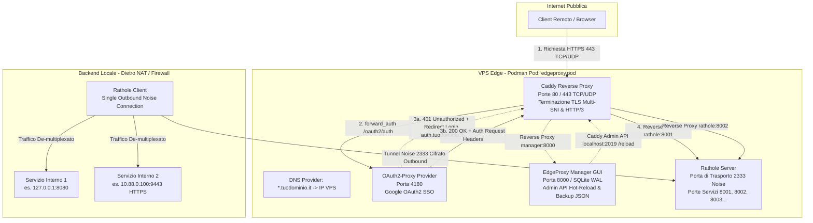

# EdgeProxy — Master Architecture & Complete Operational Guide

> **Documento Unificato di Riferimento Tecnico e Operativo**  
> **Ambiente**: VPS Edge (Server-Side) + Backend Locale (Client-Side)  
> **Componenti Core**: Caddy, OAuth2-Proxy (Google OAuth2 SSO), Rathole (Noise Protocol), EdgeProxy Manager (Web GUI)
> **Container Runtime**: Podman / Systemd Quadlet Pod Architecture

---

## 1. Visione Generale e Motivazione del Progetto

### 1.1 Sostituzione Self-Hosted di Cloudflare Tunnel + Cloudflare Access
Nel panorama dell'esposizione sicura dei servizi applicativi self-hosted (in esecuzione su server locali, homelab o datacenter on-premise privi di IP pubblico statico o dietro CGNAT/firewall restrittivi), **Cloudflare Tunnel** (cloudflared) combinato con **Cloudflare Access** è divenuto uno standard di fatto per semplicità e comodità. Tuttavia, questo paradigma comporta compromessi significativi:
- **Perdita di Sovranità del Dato**: Ciascun pacchetto in transito viene decifrato sui nodi di edge di Cloudflare prima di essere re-incapsulato verso il tunnel, esponendo cookie di sessione, intestazioni HTTP e payload applicativi all'operatore CDN.
- **Vendor Lock-In e Limiti di Licenza**: Le policy di accesso zero-trust gratuite sono soggette a limitazioni sul numero di utenti attivi, limiti di throughput sui socket, restrizioni su protocolli o streaming video/audio, e repentini cambi di pricing/termini di servizio.
- **Downtime Centralizzato**: Un'interruzione o policy block su Cloudflare rende inaccessibili tutte le applicazioni interne.

**EdgeProxy** realizza una sostituzione self-hosted completa, indipendente e ad alte prestazioni, riproducendo la medesima user experience:
1. **Nessuna porta in ingresso aperta** sul router/firewall del backend locale (NAT traversal trasparente).
2. **Reverse tunnel outbound cifrato con Noise Protocol** (`Noise_NN_25519_ChaChaPoly_BLAKE2s`) da backend locale a VPS su porta 2333.
3. **Terminazione TLS multi-dominio automatica** con certificati Let's Encrypt / ZeroSSL e rotazione automatica log di accesso (20MB, 5 keep, 14 giorni retention).
4. **Perimetro Zero-Trust con Autenticazione Google OAuth2 SSO** (oauth2-proxy) con whitelisting degli indirizzi email autorizzati.
5. **Pannello di Gestione Web GUI (EdgeProxy Manager)** centralizzato con SQLite in WAL Mode (busy_timeout 5000ms), protezione CSRF perimetro Origin, e funzione di Backup/Ripristino JSON atomico.

---

## 2. Architettura Tecnica del Sistema

### 2.1 Diagramma Concettuale dei Flussi



### 2.2 Flusso Dettagliato del Traffico (End-to-End)
1. **Risoluzione DNS**: L'utente remoto interroga i record DNS per `servizio1.tuodominio.it` o `auth.tuodominio.it`, risolvendo sull'IPv4 pubblico della VPS.
2. **Connessione TLS (Caddy)**: Caddy intercetta la connessione sulla porta `443`. In base al campo SNI (Server Name Indication), seleziona o rilascia automaticamente il certificato X.509 da Let's Encrypt o ZeroSSL.
3. **Verifica Perimetrale (Authelia forward_auth)**:
   - Caddy invia una sotto-richiesta sincrona ad Authelia via HTTP (`http://authelia:9091/api/authz/forward-auth`).
   - Se l'utente non possiede un cookie di sessione valido (`authelia_session`) con 2FA superata, Authelia risponde con `HTTP 401 Unauthorized` e Caddy reindirizza l'utente a `https://auth.tuodominio.it/?rd=https://servizio1.tuodominio.it`.
   - Se la sessione è autenticata e valida, Authelia risponde con `HTTP 200 OK`, iniettando header HTTP sicuri (`Remote-User`, `Remote-Groups`, `Remote-Email`, `Remote-Name`).
4. **Instradamento Interno (Caddy -> Rathole Server)**:
   - Caddy inoltra la richiesta autorizzata alla porta di binding corrispondente esposta da Rathole Server all'interno della rete Podman `edge_net` (es. `rathole:8001`).
5. **Multiplexing e Canale Cifrato (Rathole Server -> Rathole Client)**:
   - Il server Rathole incapsula lo stream TCP nel canale di trasporto stabilito outbound dal Rathole Client sulla porta `2333`.
   - I frame di dati viaggiano cifrati (tramite handshake con token per-servizio e cifratura TCP o Noise protocol) attraverso la connessione persistente preesistente.
6. **Consegna al Backend Locale**:
   - Rathole Client spacchetta i frame e si connette direttamente all'indirizzo locale configurato (es. `127.0.0.1:8080` oppure verso un altro host LAN `10.88.0.100:9443`).

### 2.3 Canale del Tunnel Rathole
- **Singola Connessione Outbound**: Il client remoto sul backend necessita esclusivamente di connettività in uscita verso `<IP_PUBBLICO_VPS>:2333`. Nessun port forwarding né apertura porte su router/firewall NAT.
- **Multiplexing Multi-Servizio**: Tutti i servizi (`service1`, `service2`, `manager`, ecc.) condividono lo stesso canale di controllo/trasporto sulla porta `2333`, venendo smistati internamente in base al nome del servizio e al token di sicurezza associato.
- **Low Overhead**: Scritto in Rust, Rathole garantisce zero-copy I/O e latenza di transito sub-millisecondo senza il sovraccarico di overlay VPN complessi (es. WireGuard o OpenVPN).

### 2.4 Gestione Multi-SNI TLS in Caddy
Caddy gestisce nativamente il protocollo ACME con:
- **Supporto HTTP-01**: Verifica automatica sulle porte `80` e `443` per tutti i domini e sottodomini puntati all'IP della VPS.
- **Snippet Modulari**: Utilizzo dello snippet `(authelia_auth)` per applicare `forward_auth` in modo dichiarativo e compatto senza duplicazione di codice:
  ```caddyfile
  (authelia_auth) {
      forward_auth authelia:9091 {
          uri /api/authz/forward-auth
          copy_headers Remote-User Remote-Groups Remote-Email Remote-Name
      }
  }
  ```
- **Dual Engine CA**: Alternanza automatica e fallback trasparente tra Let's Encrypt e ZeroSSL in caso di rate-limiting.

### 2.5 Protocolli di Trasporto e Prestazioni: HTTP/2 e HTTP/3 (QUIC)
EdgeProxy sfrutta l'architettura dual-stack di Caddy per combinare massima compatibilità e massime prestazioni:
- **Lato Client/Internet verso VPS**: Caddy negozia automaticamente **HTTP/2** (su TCP 443 via TLS ALPN `h2`) e **HTTP/3 QUIC** (su UDP 443 annunciato dal server tramite header `Alt-Svc`). Questo assicura:
  - **Zero Round-Trip Time (0-RTT)** per resume di sessioni TLS già note.
  - **Multiplexing senza Head-of-Line Blocking**: la perdita di singoli pacchetti UDP isolati non blocca gli stream paralleli all'interno della stessa connessione.
  - **Connection Migration trasparente**: i client mobili mantengono attive le connessioni applicative anche transitando da Wi-Fi a rete cellulare 4G/5G grazie ai Connection ID di QUIC indipendenti dalla tupla IP/Porta.
- **Terminazione a livello Edge**: Caddy termina la connessione QUIC/UDP e la cifratura TLS direttamente sulla VPS, inoltrando poi il traffico L7 verso il tunnel Rathole (e verso il backend locale) tramite sessioni HTTP/1.1 o HTTP/2 su stream TCP stabile all'interno della rete virtuale Podman `edge_net`.
- **Supporto UDP nativo in Rathole**: oltre al traffico web gestito da Caddy, Rathole supporta nativamente servizi UDP puri (es. server DNS, tunnel WireGuard, game streaming a bassa latenza) qualora si volesse instradare pacchetti UDP grezzi end-to-end attraverso il tunnel.

### 2.6 Architettura del Control Plane (EdgeProxy Manager)
- **Web UI & Backend**: Sviluppato in Python **FastAPI** monolitico con rendering lato server tramite **Jinja2** e reattività dinamica senza build-step con **HTMX**.
- **Single Source of Truth**: Database relazionale **SQLite** (`/data/edgeproxy.db`) contenente tabelle per nodi backend, servizi esposti, porte di binding Rathole, utenti e policy di accesso.
- **Motore di Sincronizzazione**: Alla creazione/modifica di un servizio o utente, il Manager rigenera atomicamente:
  - [`server/caddy/Caddyfile`](server/caddy/Caddyfile)
  - [`server/rathole/server.toml`](server/rathole/server.toml)
  - [`server/authelia/configuration.yml`](server/authelia/configuration.yml) e [`server/authelia/users_database.yml`](server/authelia/users_database.yml)
  - File di configurazione client esportabile ([`client/rathole/client.toml`](client/rathole/client.toml))
- **Hot-Reload Zero-Downtime**: Il Manager comunica con la Caddy Admin API (`POST http://caddy:2019/load`) per ricaricare la nuova configurazione senza interrompere i socket TLS attivi.

---

## 3. Prerequisiti Dettagliati

### 3.1 Requisiti VPS (Server-Side)
- **Sistema Operativo**: Distribuzione Linux a 64-bit (Debian 12 Bookworm, Ubuntu 22.04/24.04 LTS, Rocky Linux 9, Fedora 40).
- **Indirizzo IP**: 1x IPv4 Pubblico Statico dedicato.
- **Risorse Minime**: 1 vCPU, 1 GB RAM, 10 GB storage SSD.
- **Regole Firewall Provider / Security Group**:

  | Porta / Protocollo | Servizio | Scopo |
  |---|---|---|
  | `80/TCP` | Caddy (HTTP) | Sfide ACME Let's Encrypt / Redirezione HTTPS |
  | `443/TCP` | Caddy (HTTPS) | Traffico applicativo sicuro in ingresso (HTTP/1.1 e HTTP/2 via TLS) |
  | `443/UDP` | Caddy (HTTP/3 QUIC) | Traffico QUIC ad alte prestazioni (0-RTT, no head-of-line blocking) |
  | `2333/TCP` | Rathole Server | Ingresso reverse tunnel Rathole (esclusivamente dal client backend) |
  | `22/TCP` | SSH | Accesso SSH amministrativo |

  *Tutte le altre porte in ingresso devono restare rigorosamente chiuse.*

### 3.2 Configurazione DNS
Configurare presso il proprio Registrar DNS (es. Cloudflare, Namecheap, OVH) i seguenti record di tipo `A`:

| Tipo | Nome Record | Contenuto (Valore) | TTL | Descrizione |
|---|---|---|---|---|
| A | `auth.tuodominio.it` | `<IPV4_PUBBLICO_VPS>` | Automatico / 300 | Portale di Autenticazione e 2FA Authelia |
| A | `manager.tuodominio.it` | `<IPV4_PUBBLICO_VPS>` | Automatico / 300 | Dashboard EdgeProxy Manager |
| A | `service1.tuodominio.it` | `<IPV4_PUBBLICO_VPS>` | Automatico / 300 | Primo servizio backend protetto |
| A | `service2.tuodominio.it` | `<IPV4_PUBBLICO_VPS>` | Automatico / 300 | Secondo servizio backend protetto |
| A | `*.tuodominio.it` *(Consigliato)* | `<IPV4_PUBBLICO_VPS>` | Automatico / 300 | Record Wildcard per provisioning dinamico |

### 3.3 Requisiti Backend Locale (Client-Side)
- **Connettività**: Accesso a Internet in uscita verso `<IPV4_PUBBLICO_VPS>:2333/TCP`.
- **Nessuna Porta in Ingresso**: Non è necessario alcun IP pubblico, NAT port-forwarding o DMZ sul router casalingo/aziendale. Funziona nativamente dietro reti CGNAT (Starlink, Connessioni 4G/5G, ISP con IPv4 condiviso).
- **Ambiente Host**: Server locale, Raspberry Pi, VM o NAS (es. Proxmox, TrueNAS, Debian/Ubuntu) con Podman installato.

---

## 4. Cosa Installare e Dove

### 4.1 Sulla VPS (Server-Side)

#### Debian / Ubuntu:
```bash
# Aggiornamento pacchetti e installazione prerequisiti
sudo apt-get update && sudo apt-get install -y podman systemd openssl curl git

# Verifica installazione
podman --version
systemctl --version
```

#### RHEL / Rocky Linux / Fedora:
```bash
# Installazione pacchetti container
sudo dnf install -y podman systemd openssl curl git

# Verifica installazione
podman --version
systemctl --version
```

### 4.2 Sul Backend Locale (Client-Side)

#### Debian / Ubuntu / Raspberry Pi OS:
```bash
sudo apt-get update && sudo apt-get install -y podman systemd
```

#### RHEL / Fedora:
```bash
sudo dnf install -y podman systemd
```

---

## 5. Guida Operativa al Deployment Passo-Passo

### 5.1 Lato VPS (Server-Side)

#### Passo 1: Posizionamento dei File
Clonare il repository o copiare la cartella [`server/`](server/) sulla VPS:
```bash
mkdir -p /opt/edgeproxy
cd /opt/edgeproxy
# Copiare l'intero contenuto della cartella server del progetto
# Struttura attesa:
# /opt/edgeproxy/
# ├── Containerfile
# ├── supervisord.conf
# ├── .env.example
# ├── quadlet/
# │   ├── edgeproxy.pod
# │   ├── caddy.container
# │   ├── authelia.container
# │   ├── rathole.container
# │   ├── caddy_data.volume
# │   └── caddy_config.volume
# ├── caddy/
# │   └── Caddyfile
# ├── authelia/
# │   ├── configuration.yml
# │   └── users_database.yml
# └── rathole/
#     └── server.toml
```

#### Passo 2: Generazione Segreti Crittografici e Configurazione `.env`
Creare il file `.env` a partire da [`server/.env.example`](server/.env.example) e valorizzare i secret:
```bash
cp .env.example .env

# Generazione dei segreti casuali a 64 caratteri esadecimali
JWT_SECRET=$(openssl rand -hex 32)
SESSION_SECRET=$(openssl rand -hex 32)
STORAGE_KEY=$(openssl rand -hex 32)
TOKEN_S1=$(openssl rand -hex 24)
TOKEN_S2=$(openssl rand -hex 24)

# Inserimento automatico o manuale nel file .env
sed -i "s/insecure_default_jwt_secret_please_generate_random_key_min_64_bytes/$JWT_SECRET/" .env
sed -i "s/insecure_default_session_secret_please_generate_random_key_min_64_bytes/$SESSION_SECRET/" .env
sed -i "s/insecure_default_storage_encryption_key_min_64_bytes/$STORAGE_KEY/" .env
sed -i "s/replace_with_a_secure_token_for_service1/$TOKEN_S1/" .env
sed -i "s/replace_with_a_secure_token_for_service2/$TOKEN_S2/" .env

# Modificare DOMAIN e ACME_EMAIL con i propri valori reali
nano .env
```

Assicurarsi che anche [`server/rathole/server.toml`](server/rathole/server.toml) utilizzi gli stessi token generati (`TOKEN_S1` e `TOKEN_S2`).

#### Passo 3: Generazione Hash Password Argon2id per Authelia
Per rispettare le best-practice di sicurezza (nessuna installazione di binari o utility sul sistema host), generiamo l'hash della password amministratore tramite un container Podman effimero di Authelia:
```bash
# Esecuzione in container effimero (--rm)
podman run --rm docker.io/authelia/authelia:latest authelia crypto hash generate argon2 --password "LaTuaPasswordSicura123!"
```
L'output generato sarà simile a:
`$argon2id$v=19$m=65536,t=3,p=4$vB0y3k1...`

Copiare tale stringa e incollarla nel campo `password:` in [`server/authelia/users_database.yml`](server/authelia/users_database.yml):
```yaml
users:
  admin:
    disabled: false
    displayname: "Amministratore EdgeProxy"
    password: "$argon2id$v=19$m=65536,t=3,p=4$vB0y3k1..."
    email: "admin@tuodominio.it"
    groups:
      - admins
      - dev
```

#### Passo 4: Avvio del Server VPS con Podman Quadlet (systemd)

La gestione raccomandata su VPS Edge è basata su **Podman Quadlets** per systemd utente (rootless):

1. **Build dell'immagine locale del Server**:
   ```bash
   cd /opt/edgeproxy/server
   podman build -t edgeproxy-server -f Containerfile .
   cd ..
   ```

2. **Copia dei file quadlet nella directory systemd dell'utente**:
   ```bash
   mkdir -p ~/.config/containers/systemd/
   cp /opt/edgeproxy/server/quadlet/* ~/.config/containers/systemd/
   ```

3. **Ricarica e avvio del servizio nativo systemd**:
   ```bash
   systemctl --user daemon-reload
   systemctl --user start edgeproxy-server
   ```

4. **Abilitazione avvio al boot e persistenza utente**:
   ```bash
   systemctl --user enable edgeproxy-server
   loginctl enable-linger $USER
   ```

5. **Verifica dello stato e Log**:
   ```bash
   systemctl --user status edgeproxy-server
   journalctl --user -u edgeproxy-server -f
   ```
   `supervisord` all'interno del container avvia automaticamente Rathole (porta 2333 e listener 8001/8002), Authelia (porta 9091) e Caddy (porte 80 e 443 TCP/UDP), aggregando i log di tutti i processi su systemd journal e Podman logs.

---

### 5.2 Lato Backend (Client-Side)

#### Passo 1: Posizionamento dei File
Sul server/host locale dietro NAT:
```bash
mkdir -p /opt/edgeproxy-client
cd /opt/edgeproxy-client
# Copiare l'intero contenuto della cartella client/
# ├── Containerfile
# ├── quadlet/
# │   └── edgeproxy-client.container
# └── rathole/
#     └── client.toml
```

#### Passo 2: Configurazione di [`client/rathole/client.toml`](client/rathole/client.toml)
Modificare il file inserendo l'IP pubblico della VPS, i token corrispondenti e gli indirizzi target reali:
```toml
[client]
remote_addr = "<IPV4_PUBBLICO_VPS>:2333"

[client.transport]
type = "tcp"

[client.transport.tcp]
nodelay = true

[client.services.service1]
token = "<TOKEN_S1_GENERATO_PRECEDENTEMENTE>"
local_addr = "127.0.0.1:8080" # Oppure un IP della LAN: es. 192.168.1.50:80

[client.services.service2]
token = "<TOKEN_S2_GENERATO_PRECEDENTEMENTE>"
local_addr = "10.88.0.100:9443" # Servizio con HTTPS interno
```

#### Passo 3: Avvio del Client Rathole
È possibile scegliere tra tre modalità di esecuzione:

**Opzione A: Singolo Container con podman build & run (Containerfile Consigliato)**
```bash
# 1. Costruzione dell'immagine all-in-one del client
cd /opt/edgeproxy-client
podman build -t localhost/edgeproxy-client:latest -f Containerfile .

# 2. Avvio del container con network host e variabili di sincronizzazione
podman run -d \
  --name edgeproxy-client \
  --restart unless-stopped \
  --network host \
  -e SERVER_URL="https://auth.edge.mpv.cx" \
  -e SYNC_TOKEN="c7210be7a226b826f5c6c005cc422947678629d1e23ca19d" \
  -e INTERVAL=15 \
  -v %h/edgeproxy/client/data:/etc/rathole:z \
  localhost/edgeproxy-client:latest

# 3. Verifica dei log del tunnel
podman logs -f edgeproxy-client
```

**Procedura Standard Consigliata: Tramite Systemd Quadlet All-in-One**
I Quadlet di Podman permettono a systemd di gestire il container client all-in-one autonomamente, con ricarica a caldo e polling ogni 15s senza timer ausiliari:
```bash
# 1. Compilare l'immagine client locale
cd ~/edgeproxy/client
podman build -t localhost/edgeproxy-client:latest -f Containerfile .

# 2. Copiare il file Quadlet in ~/.config/containers/systemd/
mkdir -p ~/.config/containers/systemd/
cp client/quadlet/edgeproxy-client.container ~/.config/containers/systemd/

# 3. Ricaricare systemd e avviare il servizio client
systemctl --user daemon-reload && systemctl --user restart edgeproxy-client

# 4. Verifica dello stato e log in tempo reale
systemctl --user status edgeproxy-client
journalctl --user -u edgeproxy-client -f
```

---

## 6. Autenticazione 2FA e Google Authenticator

### 6.1 Funzionamento del Protocollo TOTP (RFC 6238)
L'autenticazione a due fattori adottata si basa sullo standard Time-Based One-Time Password:
- **Issuer**: Configurato come `EdgeProxy (tuodominio.it)` in [`server/authelia/configuration.yml`](server/authelia/configuration.yml).
- **Algoritmo**: `SHA1` (garantisce la massima compatibilità universale con Google Authenticator, Microsoft Authenticator, FreeOTP, Bitwarden).
- **Lunghezza Codice**: 6 cifre numeriche.
- **Finestra Temporale (Period)**: 30 secondi.
- **Tolleranza (Skew)**: 1 intervallo (accetta ±30s per compensare eventuali lievi disallineamenti di clock NTP).

### 6.2 Procedura di Onboarding 2FA "Zero-SMTP"
Tradizionalmente Authelia richiede l'invio di un'email con un link di validazione per registrare un nuovo token TOTP. In contesti self-hosted o privi di server SMTP dedicato, EdgeProxy adotta la modalità **Zero-SMTP**:
1. In [`server/authelia/configuration.yml`](server/authelia/configuration.yml) il notifier è configurato in modalità `filesystem`:
   ```yaml
   notifier:
     filesystem:
       filename: '/config/notification.txt'
   ```
2. **Primo Accesso e Registrazione**:
   - L'utente naviga su `https://auth.tuodominio.it`.
   - Inserisce username (`admin`) e password (quella configurata in Argon2id).
   - Authelia informa che è richiesta la registrazione del secondo fattore (TOTP) e scrive il link di verifica all'interno del file `/config/notification.txt`.
3. **Approvazione tramite Web UI / Shell**:
   - Con EdgeProxy Manager, il token di registrazione viene intercettato ed esposto direttamente a schermo con **QR Code inline**.
   - In alternativa manuale tramite VPS:
     ```bash
     cat server/authelia/notification.txt
     ```
   - Cliccare sul link o copiare l'URL nel browser per far apparire immediatamente il QR Code sul portale Authelia.
4. **Scansione con Google Authenticator**:
   - Aprire Google Authenticator sullo smartphone e inquadrare il QR Code.
   - Digitare il codice a 6 cifre visualizzato sull'app per confermare l'accoppiamento.
   - **Verifica Live**: La conferma immediata previene lockout accidentali (il dispositivo viene marcato attivo solo se l'utente dimostra di ricevere correttamente i codici).

### 6.3 Configurazione Notificatore SMTP (Opzionale)
Qualora si disponga di un server SMTP (es. Brevo, Sendgrid, Mailgun o SMTP aziendale), è possibile sostituire la sezione `notifier` in [`server/authelia/configuration.yml`](server/authelia/configuration.yml):
```yaml
notifier:
  smtp:
    address: 'smtp.example.com:587'
    timeout: 5s
    username: 'apikey'
    password: 'secret-smtp-password'
    sender: 'EdgeProxy Security <auth@tuodominio.it>'
    identifier: 'tuodominio.it'
    startup_check_address: 'test@tuodominio.it'
```

---

## 7. Accesso alla Web UI di Gestione (EdgeProxy Manager)

### 7.1 Accesso Standard via Web (Produzione)
L'EdgeProxy Manager viene esposto all'URL:
`https://manager.tuodominio.it`

**Flusso di Sicurezza Applicato**:
1. La richiesta arriva a Caddy sulla porta `443`.
2. Caddy attiva lo snippet `(authelia_auth)`.
3. L'utente viene reindirizzato ad Authelia (`https://auth.tuodominio.it`) e deve superare il login 1FA (password Argon2id) + 2FA (Google Authenticator).
4. La policy di Authelia valida l'appartenenza al gruppo `admins`.
5. Caddy inoltra la richiesta autorizzata al container `edgeproxy-manager` (porta `8000`).

### 7.2 Accesso di Emergenza / Bootstrap Iniziale (SSH Tunnel)
In fase di primissimo bootstrap, o in caso di errore nella configurazione dei domini pubblici o certificati TLS, il Manager può essere raggiunto in totale sicurezza legando la porta `8000` solo su `127.0.0.1` sulla VPS:
```bash
# Eseguito dal proprio computer locale verso la VPS:
ssh -L 8000:127.0.0.1:8000 utente@<IPV4_PUBBLICO_VPS>
```
Una volta aperto il tunnel, navigare nel browser locale su:
`http://localhost:8000`
Questo garantisce un canale di gestione "Out-Of-Band" inviolabile anche a perimetro DNS/TLS compromesso.

---

## 8. Aggiunta di Nuovi Servizi End-to-End

### 8.1 Procedura Guidata tramite Web UI (EdgeProxy Manager)
1. Effettuare il login sulla dashboard `https://manager.tuodominio.it`.
2. Cliccare su **"Nuovo Servizio"**:
   - **Nome Servizio**: es. `grafana`
   - **Sottodominio FQDN**: `grafana.tuodominio.it`
   - **Target Locale Backend**: `127.0.0.1:3000` (oppure `https://192.168.1.120:3000` con switch "Ignore TLS" abilitato se usa certificato self-signed).
   - **Policy di Protezione**: `two_factor` (oppure `bypass` se si desidera esporlo pubblicamente senza 2FA).
   - **Gruppi Autorizzati**: `admins, monitoring`.
3. Cliccare su **"Salva e Applica"**:
   - Il database SQLite salva il servizio.
   - Jinja2 genera le nuove righe in Caddyfile, Rathole Server e Authelia.
   - Caddy effettua un hot-reload istantaneo via Admin API.
4. Cliccare su **"Esporta Configurazione Client"**:
   - Il Manager genera il frammento TOML da incollare nel `client.toml` del backend locale.
5. Riavviare il client Rathole sul backend (`systemctl --user restart rathole-client.service`).

---

### 8.2 Procedura Manuale tramite File di Configurazione

Qualora si operi in modalità manuale (senza Manager Web UI):

#### 1. Lato Server VPS:
- **Assegnare una nuova porta interna a Rathole** (es. `8003`) in [`server/rathole/server.toml`](server/rathole/server.toml):
  ```toml
  [server.services.grafana]
  token = "generare_token_sicuro_grafana"
  bind_addr = "0.0.0.0:8003"
  ```
- **Aggiungere il Virtual Host Caddy** in [`server/caddy/Caddyfile`](server/caddy/Caddyfile):
  ```caddyfile
  grafana.{$DOMAIN} {
      import authelia_auth
      reverse_proxy rathole:8003
  }
  ```
- **Configurare la Policy in Authelia** in [`server/authelia/configuration.yml`](server/authelia/configuration.yml):
  ```yaml
  access_control:
    rules:
      - domain: 'grafana.{{ env "DOMAIN" }}'
        policy: 'two_factor'
        subject:
          - 'group:admins'
  ```
- **Ricaricare lo Stack Server**:
  ```bash
  systemctl --user restart edgeproxy-server
  # oppure reload a caldo della sola configurazione Caddy:
  podman exec -w /etc/edgeproxy/caddy edgeproxy-server caddy reload --config /etc/edgeproxy/caddy/Caddyfile
  ```

#### 2. Lato Client Backend:
- **Aggiungere il servizio** in [`client/rathole/client.toml`](client/rathole/client.toml):
  ```toml
  [client.services.grafana]
  token = "generare_token_sicuro_grafana"
  local_addr = "127.0.0.1:3000"
  ```
- **Ricaricare il client**:
  ```bash
  systemctl --user restart edgeproxy-client
  ```

---

## 9. Manutenzione, Comandi Utili e Troubleshooting

### 9.1 Visualizzazione Log e Gestione dei Servizi Quadlet
I log in tempo reale sono fondamentali per diagnosticare eventuali handshake falliti o errori di autenticazione:
```bash
# Log aggregati del server tramite systemd journal
journalctl --user -u edgeproxy-server -f

# Log del client tramite systemd journal
journalctl --user -u edgeproxy-client -f

# Log diretti tramite podman
podman logs -f edgeproxy-server
podman logs -f edgeproxy-client
```

### 9.2 Ricarica della Configurazione Caddy Senza Downtime
Caddy non richiede il riavvio del container per aggiornare le regole dei virtual host:
```bash
podman exec -it edgeproxy-caddy caddy reload --config /etc/caddy/Caddyfile
```

---

### 9.3 Troubleshooting Quadlet: "short-name resolution enforced but cannot prompt without a TTY"

All'avvio dei servizi gestiti da Quadlet (`systemctl --user start edgeproxy-server` o `sudo systemctl start edgeproxy-server`), l'errore seguente:
```text
Error: short-name resolution enforced but cannot prompt without a TTY
podman[27298]: image pull-error asphalter/edgeproxy-server:latest short-name resolution enforced but cannot prompt without a TTY
```
è causato da una combinazione di tre fattori dell'ecosistema Podman / systemd:

1. **Short-Name Resolution in assenza di TTY**:
   Podman ha come impostazione predefinita `short-name-mode="enforcing"`. Quando un'immagine viene referenziata senza un registry esplicito (es. `asphalter/edgeproxy-server:latest` o `edgeproxy-server:latest`), Podman cerca di interrogare i registry configurati in `/etc/containers/registries.conf` chiedendo conferma interattiva all'utente. Quando il comando viene eseguito da un servizio systemd (background privo di pseudoterminale TTY), Podman non può richiedere l'input e l'avvio fallisce immediatamente.
   - **Rimedio**: Forzare il namespace locale esplicito `Image=localhost/edgeproxy-server:latest` in [`server/quadlet/edgeproxy-server.container`](server/quadlet/edgeproxy-server.container) e `Image=localhost/edgeproxy-client:latest` in [`client/quadlet/edgeproxy-client.container`](client/quadlet/edgeproxy-client.container).

2. **Direttiva `AutoUpdate=registry`**:
   Se presente nella sezione `[Container]` del file Quadlet, `AutoUpdate=registry` ordina a systemd/podman di verificare la presenza di nuove immagini su un registry remoto. Per immagini compilate in locale con `podman build`, questa direttiva deve essere **tassativamente rimossa**, altrimenti Podman tenterà di contattare un registry esterno provocando il medesimo fallimento.

3. **Discrepanza di Storage Root vs Rootless**:
   - Se i file Quadlet vengono posizionati in `/etc/containers/systemd/`, essi vengono presi in carico dal demone `systemd[1]` (root), che cerca le immagini in `/var/lib/containers/storage`.
   - Se l'utente ha compilato l'immagine come utente non privilegiato (`podman build`), l'immagine risiede in `~/.local/share/containers/storage`. Root non la trova e deduce erroneamente di doverla scaricare da un registry pubblico.
   - **Modalità Rootless (Raccomandata)**:
     - Installare i file Quadlet in `~/.config/containers/systemd/`.
     - Compilare con l'utente normale:
       ```bash
       podman build -t localhost/edgeproxy-server:latest ./server
       ```
     - Ricaricare con `systemctl --user daemon-reload && systemctl --user start edgeproxy-server`.
   - **Modalità Root (Sistema)**:
     - Se si desidera avviare a livello di sistema in `/etc/containers/systemd/`, compilare con `sudo`:
       ```bash
       sudo podman build -t localhost/edgeproxy-server:latest ./server
       ```
     - Sostituire la macro `%h` (che per root si espanderebbe in `/root`) con il percorso assoluto della directory di progetto (es. `/opt/edgeproxy`).
     - Gestire il demone con `sudo systemctl daemon-reload && sudo systemctl start edgeproxy-server`.

---

### 9.4 Tabella Diagnostica: Risoluzione Problemi Comuni

| Sintomo / Errore | Causa Radice | Soluzione Risolutiva |
|---|---|---|
| **Quadlet: short-name resolution enforced but cannot prompt without a TTY** | Nome immagine privo di `localhost/`, presenza di `AutoUpdate=registry` o discrepanza tra storage utente e demone root. | Seguire la procedura dettagliata nella sezione 9.3: forzare `localhost/`, rimuovere `AutoUpdate=registry`, allineare l'utente di build all'utente del servizio Quadlet. |
|---|---|---|
| **Caddy restituisce errore 502 Bad Gateway** | Il servizio Rathole non è in ascolto sulla porta associata (`8001`, `8002`) o il client Rathole locale non è connesso. | 1. Verificare i log di `edgeproxy-rathole` per assicurarsi che il client sia connesso.<br/>2. Verificare che il token in [`server/rathole/server.toml`](server/rathole/server.toml) coincida perfettamente con [`client/rathole/client.toml`](client/rathole/client.toml). |
| **Errore TLS / Certificato non valido su browser** | Mancata risoluzione DNS o blocco porta 80/443 durante la verifica ACME. | 1. Verificare con `dig +short servizio.tuodominio.it` che il record A punti all'IP pubblico della VPS.<br/>2. Verificare che il firewall del provider cloud consenta il traffico in ingresso su `80/TCP` e `443/TCP`. |
| **Authelia: "401 Unauthorized" o loop di login** | Cookie non validi sul dominio principale o discrepanza nel parametro `domain` di sessione. | Verificare che in [`server/authelia/configuration.yml`](server/authelia/configuration.yml) il campo `cookies.domain` corrisponda al dominio di secondo livello (es. `tuodominio.it`) e non a un sottodominio specifico. |
| **Google Authenticator: "Codice non valido" (Invalid OTP)** | Disallineamento dell'orologio NTP tra la VPS e il dispositivo mobile dell'utente. | Eseguire `timedatectl status` sulla VPS e sincronizzare l'orologio di sistema con `chrony` o `systemd-timesyncd`. Verificare che anche lo smartphone abbia la sincronizzazione automatica dell'orario attiva. |
| **Rathole Client: "Connection refused (os error 111)"** | Porta `2333` bloccata dal firewall della VPS o Rathole Server non avviato. | Verificare che il container `edgeproxy-rathole` sia in stato `Up` e che la porta `2333/TCP` sia aperta nel firewall della VPS (`ufw allow 2333/tcp` o tramite pannello di controllo cloud). |
| **Backend Target HTTPS interno fallisce con SSL Error** | Il servizio backend usa certificato self-signed non fidato da Rathole o Caddy. | Se Caddy si connette a target HTTPS diretti, specificare `transport http { tls_insecure_skip_verify }`. Con Rathole, Rathole inoltra stream TCP grezzi a livello 4, quindi il tunnel è trasparente al payload TLS. |

---

## 10. Conclusioni e Riepilogo Architetturale

La presente architettura unificata garantisce la sostituzione completa e senza compromessi di Cloudflare Tunnel e Cloudflare Access:
- **Sovranità Assoluta**: Nessun payload transita su infrastrutture terze non crittografato.
- **Sicurezza Zero-Trust**: Autenticazione multi-fattore TOTP perimetrale prima che qualsiasi byte tocchi i backend locali.
- **Resilienza**: Stack containerizzato portabile, isolato tramite Podman e configurabile sia via file dichiarativi sia tramite la comoda interfaccia Web GUI centralizzata.
